<!--
Guide utilisateur de Moanui. Source unique : ce fichier + les captures de docs/guide/images.
Toute nouvelle fonction ou modification d'ergonomie entraîne la mise à jour du texte, des captures
(outils/captures_guide.js) et la reconstruction du Word et du PDF (outils/construire_guide.py).
-->

<!-- preface -->
## Guide d'utilisation complet

Ce guide regroupe l'essentiel des options, fonctionnalités et subtilités de **Moanui**, la plateforme de traitement, d'analyse et de représentation des données halieutiques. Il remplace le guide de la version 0.1, écrite en R : l'outil a été entièrement reconstruit en 2026 pour être installé sans droits d'administrateur, rester rapide sur des centaines de milliers de lignes et garder une trace de chaque opération.

L'objectif de l'outil est de faciliter le traitement en routine des données de pêche : SACROIS et journaux de bord, positions VMS, référentiels, suivis de terrain. Il doit rester simple d'utilisation, intuitif et rapide, sans logiciel annexe et sans avoir besoin de programmer. Chaque résultat (jeu de données, graphique, carte, analyse statistique, suivi de quota) est accompagné d'une **fiche méthode** qui explique comment il a été obtenu, avec ses références.

Le guide est mis à jour à chaque évolution de l'application : chaque nouvelle fonction, ou modification de l'interface, entraîne la mise à jour du texte et des captures d'écran. Toutes les données présentées sont **fictives** (flottille « MOANUI 01 » à « MOANUI 36 ») : elles sont fournies avec l'application, dans le dossier `exemples/donnees_demo`, pour vous entraîner.

Tous les ajouts sont possibles : en cas de besoin, contactez la personne en charge du développement pour envisager l'ajout de fonctionnalités, de traitements ou de routines. Les nouvelles versions sont publiées dans l'onglet *Releases* du dépôt, avec leurs notes de version.

En cas de problème, de bug ou d'erreur, prenez une capture d'écran du message et notez ce que vous faisiez : cela permet de vous dépanner rapidement. Le chapitre 21 répond aux problèmes les plus courants.

> **À retenir.** Le fichier que vous importez n'est jamais modifié : Moanui en garde une copie intacte et applique vos traitements sous la forme d'une *recette*, liste d'étapes que vous pouvez relire, désactiver, modifier ou annuler à tout moment.
<!-- /preface -->

# Partie 1 : Installation et prise en main

## 1. Installation de l'application

### 1.1. Installer Moanui (recommandé)

Moanui est distribué sous la forme d'un **installateur Windows**, `Moanui-installation.exe`, disponible dans l'onglet *Releases* du dépôt GitHub. L'installation se fait pour l'utilisateur courant : **aucun droit d'administrateur n'est nécessaire**.

1. Téléchargez `Moanui-installation.exe` avec votre navigateur.
2. Lancez-le. Au premier lancement, Windows peut afficher « Windows a protégé votre ordinateur » : l'application n'est pas encore signée numériquement. Cliquez sur **Informations complémentaires**, puis sur **Exécuter quand même**.
3. Suivez l'assistant. Cochez « Créer une icône sur le bureau » si vous le souhaitez, puis lancez Moanui à la fin de l'installation.

Une fenêtre noire (la console) s'ouvre, puis Moanui s'affiche dans votre navigateur à l'adresse `http://127.0.0.1:8765`. **La fenêtre noire doit rester ouverte** pendant l'utilisation : la fermer arrête Moanui.

Tableau : Emplacements utilisés par Moanui sur l'ordinateur
| Élément | Emplacement | Remarque |
|---|---|---|
| Programme | `%LOCALAPPDATA%\Programs\Moanui` | Remplacé à chaque mise à jour |
| Données de travail | `%LOCALAPPDATA%\Moanui` | Comptes, jeux, recettes, graphiques, cartes ; conservé lors des mises à jour et de la désinstallation |
| Raccourcis | Menu Démarrer, bureau (facultatif) | |
| Journal d'erreur | `moanui-erreur.log` à côté de `Moanui.exe` | Créé seulement en cas d'erreur au démarrage |

> **Sauvegarde.** Pour sauvegarder tout votre travail, copiez le dossier `%LOCALAPPDATA%\Moanui` (tapez ce chemin dans la barre d'adresse de l'explorateur de fichiers).

### 1.2. Version portable (zip)

Une version portable, `Moanui-windows.zip`, est aussi proposée. **Avant d'extraire le zip**, faites un clic droit sur le fichier, puis *Propriétés*, cochez **Débloquer** en bas de l'onglet *Général* et validez. Sans cette précaution, Windows refuse de charger les fichiers extraits d'un téléchargement : la fenêtre noire s'ouvre et se referme aussitôt (message « Failed to load Python DLL »). Extrayez ensuite le zip (clic droit, *Extraire tout*) et lancez `Moanui.exe` dans le dossier obtenu.

### 1.3. Mettre à jour

Pour mettre à jour, lancez simplement le nouvel installateur : il remplace le programme et conserve vos données. Chaque version publiée est accompagnée de **notes de version** qui listent les nouveautés. Le numéro de la version installée s'affiche en bas de la barre latérale de l'application.

## 2. Premier lancement et connexion

### 2.1. Créer le compte administrateur

Au tout premier lancement, Moanui demande de créer le compte administrateur et la première structure (comité, organisation de producteurs…). Renseignez votre nom, un identifiant de connexion, un mot de passe (8 caractères minimum, lettres et chiffres), le nom de la structure, son sigle et son type.

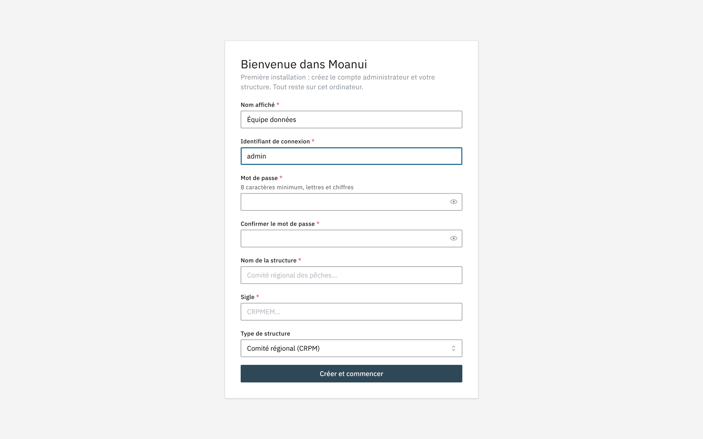

Tout reste sur votre ordinateur : rien n'est envoyé sur Internet. Les fonds de carte en ligne (IGN, OpenStreetMap) sont les seules connexions, et un fond hors ligne est toujours disponible.

### 2.2. Se connecter

Les lancements suivants affichent l'écran de connexion. Chaque personne a son compte : les opérations sont enregistrées à son nom dans l'historique et dans les fiches méthode.

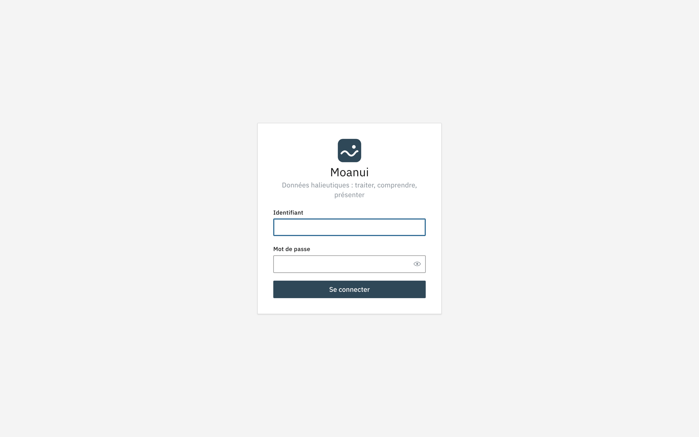

### 2.3. Structures, rôles et cloisonnement

Moanui est pensé pour plusieurs structures sur un même poste ou, à terme, un même serveur. Chaque jeu de données, graphique, carte ou suivi appartient à une structure ; une personne peut appartenir à plusieurs structures et choisit la structure active en haut de l'écran.

Tableau : Rôles et droits
| Rôle | Peut consulter | Peut traiter et enregistrer | Peut gérer la structure |
|---|---|---|---|
| Lecteur | Oui | Non | Non |
| Analyste | Oui | Oui | Non |
| Administrateur de la structure | Oui | Oui | Oui (charte graphique, membres) |
| Administrateur général | Toutes les structures | Oui | Oui, plus création des structures et des comptes |

Le cloisonnement est strict : une structure ne voit jamais les données d'une autre, sauf partage explicite d'un jeu.

## 3. Présentation de l'interface

### 3.1. La page d'accueil

La page d'accueil, intitulée **Tableau de bord**, résume l'activité de la structure active : derniers jeux de données (avec leur nombre de lignes et d'opérations), derniers graphiques, analyses statistiques et cartes enregistrés. Les boutons du haut donnent un accès direct à l'import et aux principaux outils.

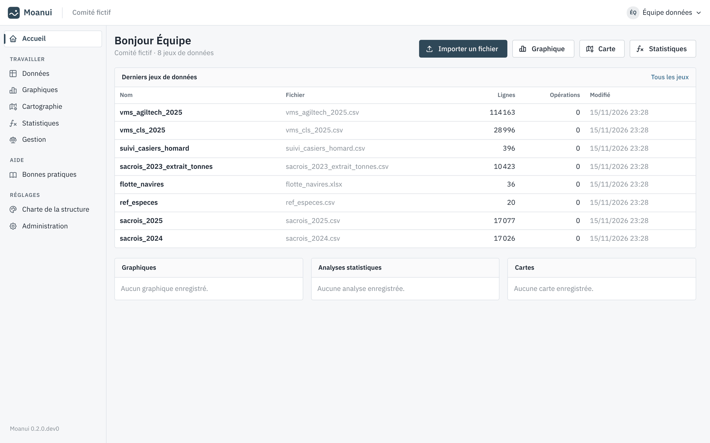

### 3.2. La barre latérale

La barre latérale, à gauche, est présente sur toutes les pages.

Tableau : Organisation de la barre latérale
| Rubrique | Page | Rôle |
|---|---|---|
| Accueil | Accueil | Résumé de l'activité |
| Travailler | Données | Importer, contrôler et traiter les fichiers |
| | Graphiques | Représenter les données |
| | Cartographie | Cartes, couches SIG, VMS |
| | Statistiques | Analyses guidées (ou en mode expert), code R |
| | Gestion | Quotas, limitations de captures |
| Aide | Bonnes pratiques | Règles appliquées par Moanui et références |
| Réglages | Charte de la structure | Logo, couleurs, police (administrateurs) |
| | Administration | Structures, comptes, journal (administrateur général) |

> **Travail en cours conservé.** Vous pouvez passer d'une page à l'autre sans perdre votre travail : un graphique en cours, même non enregistré, ou un calcul de quota réapparaissent quand vous revenez sur la page. Cette mémoire est vidée à la déconnexion.

# Partie 2 : Importer et traiter les données

## 4. Importer un fichier

### 4.1. La liste des jeux de données

La page **Données** liste les jeux de la structure : nom, nature (générique ou SACROIS), fichier source, nombre de lignes du fichier brut, nombre d'opérations appliquées et date de modification. La recherche filtre la liste par nom.

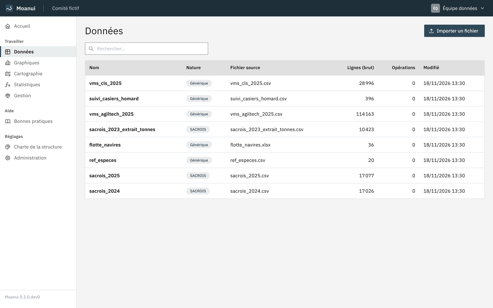

### 4.2. Importer

Cliquez sur **Importer un fichier**, puis choisissez un fichier : CSV, TXT, TSV ou Excel (XLSX). Donnez un nom au jeu, choisissez sa nature et décrivez son origine (période, fournisseur) : cette description est reprise dans la fiche méthode.

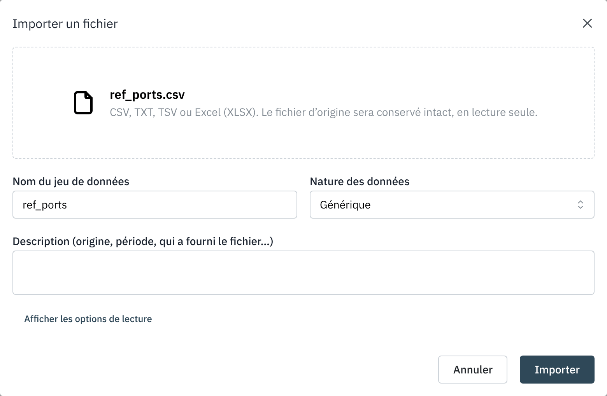

Le séparateur, l'encodage (UTF-8, Windows-1252…) et la ligne d'en-tête sont **détectés automatiquement**. En cas de doute, *Afficher les options de lecture* permet de les imposer, ainsi que la feuille d'un classeur Excel.

### 4.3. Le rapport d'import

Après l'import, un rapport indique le nombre de lignes et de colonnes, le séparateur et l'encodage retenus, et le type reconnu pour chaque colonne : texte, entier, décimal, date. Les conversions sont signalées : « virgule décimale convertie », « dates JJ/MM/AAAA ».

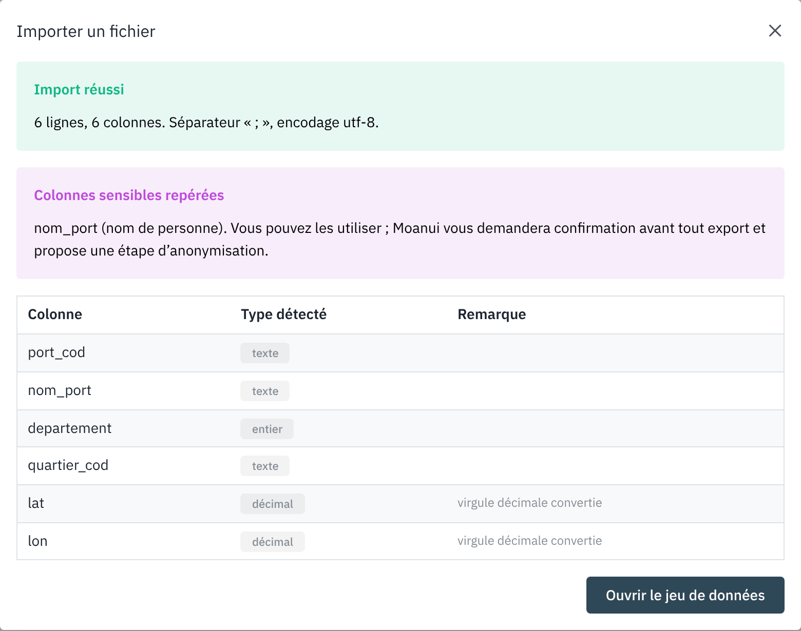

Tableau : Règles de détection des types
| Situation | Résultat |
|---|---|
| Nombres avec virgule décimale (`12,5`) | Décimal (virgule convertie) |
| Dates `JJ/MM/AAAA` ou `AAAA-MM-JJ` | Date |
| Codes avec zéros initiaux (`0123`), rectangles CIEM (`25E4`) | Gardés en texte pour ne rien perdre |
| Colonne dont une seule valeur ne se convertit pas | Gardée en texte, avec un avertissement |
| `NA`, `NULL`, cases vides | Valeur manquante |

Les **colonnes sensibles** (identifiants de navires, noms de personnes, téléphones, licences) sont repérées dès l'import. Vous pouvez travailler avec ; Moanui vous demandera confirmation avant tout export et propose une étape d'anonymisation.

> **Le fichier d'origine n'est jamais modifié.** Il est copié tel quel, en lecture seule, avec son empreinte numérique (SHA-256). Tous les traitements s'appliquent à une copie de travail, sous forme d'étapes rejouables.

## 5. Le tableau de données

### 5.1. Vue d'ensemble

Ouvrir un jeu affiche le tableau de données au centre et le **panneau de traitement** à droite. En haut, les boutons *Graphique*, *Statistiques* et *Carte* ouvrent directement ce jeu dans l'outil correspondant ; *Exporter* télécharge le résultat. Quatre onglets organisent la page : Données, Contrôle qualité, Import, Fiche méthode et notes.

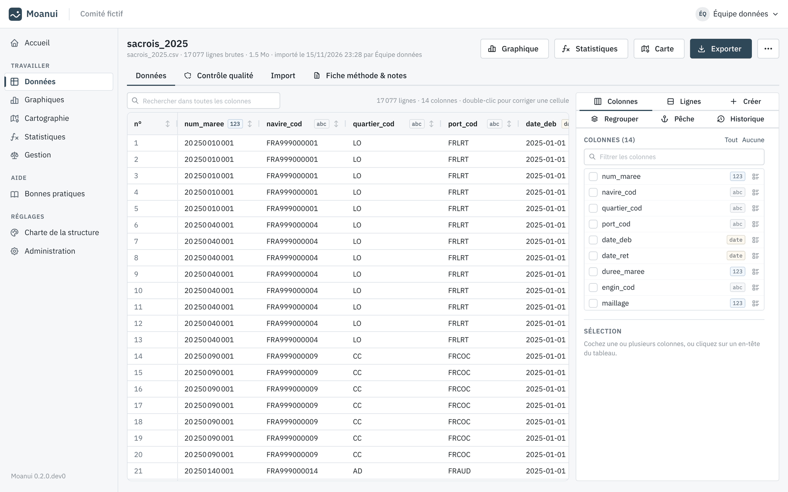

Le tableau affiche le résultat de la recette : il se met à jour à chaque opération. L'en-tête de chaque colonne indique son type (`abc` texte, `123` nombre, `date`). La flèche d'en-tête trie l'affichage ; la recherche filtre les lignes visibles. Un **double-clic sur une cellule** permet de la corriger, avec une justification enregistrée dans la recette.

### 5.2. Sélectionner des colonnes

Cliquer sur le nom d'une colonne dans l'en-tête, ou la cocher dans la liste du panneau, la sélectionne. Les opérations de l'onglet **Colonnes** s'appliquent alors à la sélection : renommer, changer le type, transformer, recoder des valeurs, remplir les vides, nettoyer le texte, fusionner, garder ou supprimer.

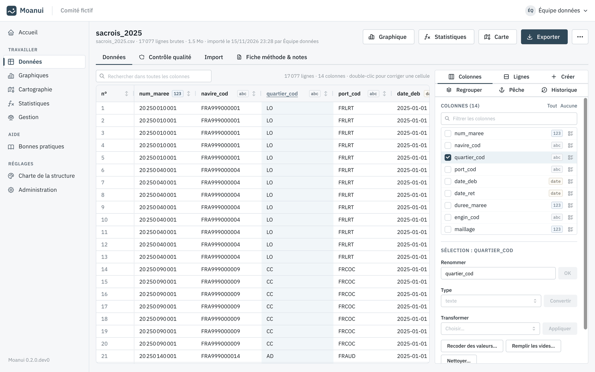

Tableau : Transformations de colonnes disponibles
| Transformation | Effet |
|---|---|
| Majuscules, minuscules | Uniformise la casse des codes et libellés |
| Supprimer les espaces en trop | Début, fin et espaces doubles |
| Arrondir, valeur absolue | Sur les colonnes numériques |
| Logarithme (ln, log10, log(1 + x)), racine carrée | Pour les distributions très asymétriques ; les valeurs impossibles restent vides |
| Classes de même largeur, classes de même effectif | Découpe une mesure en classes (ex. tailles de navires) |

Chaque transformation peut remplacer la colonne ou créer une nouvelle colonne en gardant l'original.

### 5.3. Les autres onglets du panneau

L'onglet **Lignes** filtre les lignes (garder ou supprimer celles qui répondent à des conditions), supprime les doublons et les lignes vides, trie et rappelle comment corriger une cellule.

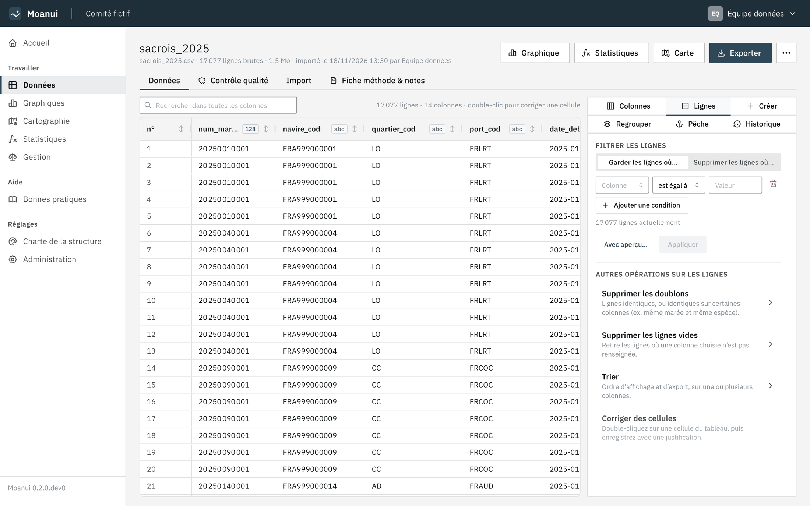

Tableau : Conditions disponibles dans les filtres
| Condition | Exemple |
|---|---|
| est égal à, est différent de | `engin_cod` est égal à `OTB` |
| est supérieur, inférieur (ou égal) à, est compris entre | `debarquement_Kg` est compris entre 0 et 5000 |
| fait partie de, ne fait pas partie de | `esp_cod_fao` fait partie de `SOL, HKE, NEP` |
| contient, ne contient pas, commence par, finit par | `stat_rect` commence par `24` |
| est vide, n'est pas vide | `engin_cod` est vide |

L'onglet **Créer** ajoute des colonnes : formule, codage selon des conditions (si… alors…), fusion de colonnes, extraction d'éléments de date, conversion d'unités, ajout depuis un référentiel, rectangle CIEM.

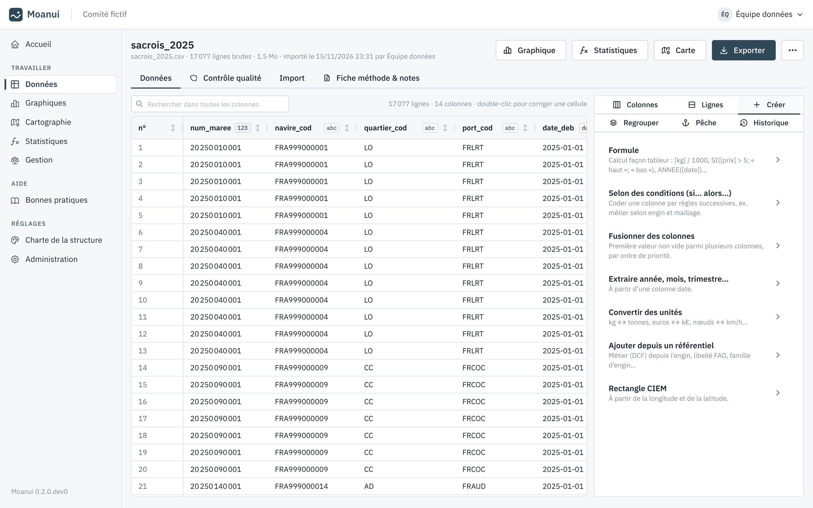

Les **formules** s'écrivent comme dans un tableur, avec des fonctions en français et le point-virgule comme séparateur. Les noms de colonnes s'écrivent entre crochets.

Tableau : Principales fonctions des formules
| Famille | Fonctions |
|---|---|
| Calcul | `ARRONDI(x; n)`, `ABS`, `RACINE`, `LN`, `LOG10`, `LOG1P`, `EXP`, `PUISSANCE(x; n)`, `MIN(a; b…)`, `MAX(a; b…)` |
| Conditions | `SI(condition; alors; sinon)`, `SIVIDE(x; remplacement)`, `ESTVIDE(x)` |
| Texte | `MAJUSCULE`, `MINUSCULE`, `SUPPRESPACE`, `LONGUEUR`, `GAUCHE(t; n)`, `DROITE(t; n)`, `STXT(t; début; n)`, `CONCAT(a; b…)`, `CONTIENT(t; motif)`, `REMPLACER(t; a; b)`, `TEXTE`, `NOMBRE` |
| Dates | `ANNEE`, `MOIS`, `JOUR`, `TRIMESTRE`, `SEMESTRE`, `SEMAINE`, `JOURSEM`, `DATE(a; m; j)`, `ECARTJOURS(d1; d2)` |

Exemple : prix moyen au kilo, vide si le poids est nul : `SI([debarquement_Kg] > 0; [debarquement_euros] / [debarquement_Kg]; VIDE)`.

L'onglet **Regrouper** résume, associe et empile des jeux (chapitre 7). L'onglet **Pêche** regroupe les traitements propres aux données halieutiques (chapitres 6 et 12). L'onglet **Historique** affiche la recette (section 5.4).

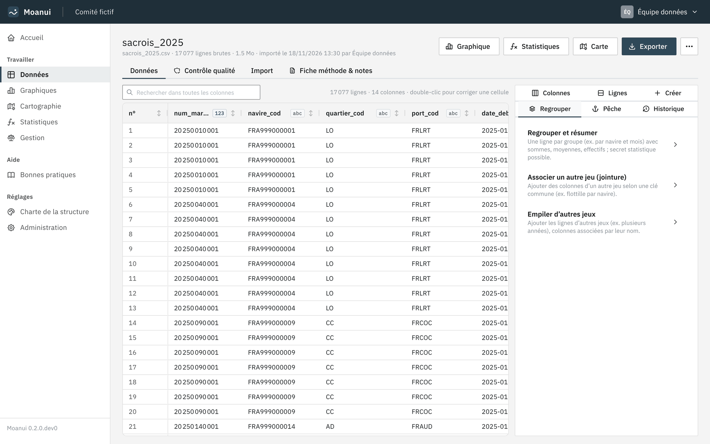

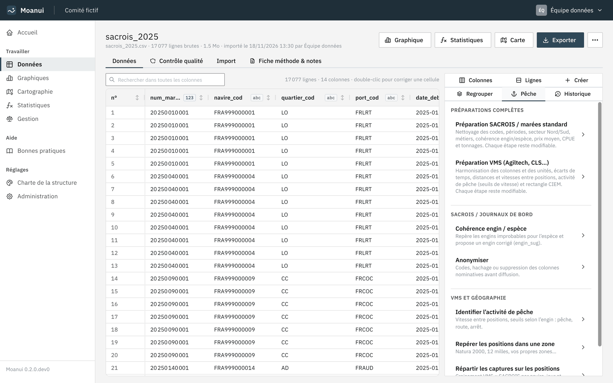

### 5.4. L'historique et la recette

Chaque opération devient une **étape** de la recette, visible dans l'onglet **Historique** : description en clair, auteur, date, justification et nombre de lignes après l'étape. Chaque étape peut être affichée (œil), désactivée (interrupteur), modifiée (crayon), déplacée (flèches) ou supprimée (corbeille). **Annuler la dernière opération** revient en arrière d'un clic.

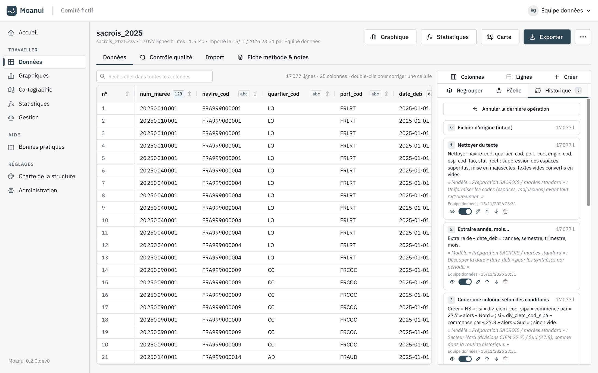

> **Aperçu à n'importe quelle étape.** L'œil d'une étape affiche les données telles qu'elles étaient à ce stade (un badge « Aperçu à l'étape n » le rappelle au-dessus du tableau) : pratique pour comprendre d'où vient une valeur.

## 6. Préparer des données SACROIS

### 6.1. Le modèle de préparation

Dans l'onglet **Pêche**, *Préparation SACROIS / marées standard* propose en une fois les étapes habituelles, adaptées aux colonnes présentes dans votre fichier : nettoyage des codes, découpage des dates, secteur Nord / Sud, métiers, contrôle engin / espèce, prix moyen, CPUE et tonnages. Décochez celles qui ne conviennent pas ; chaque étape reste modifiable ensuite.

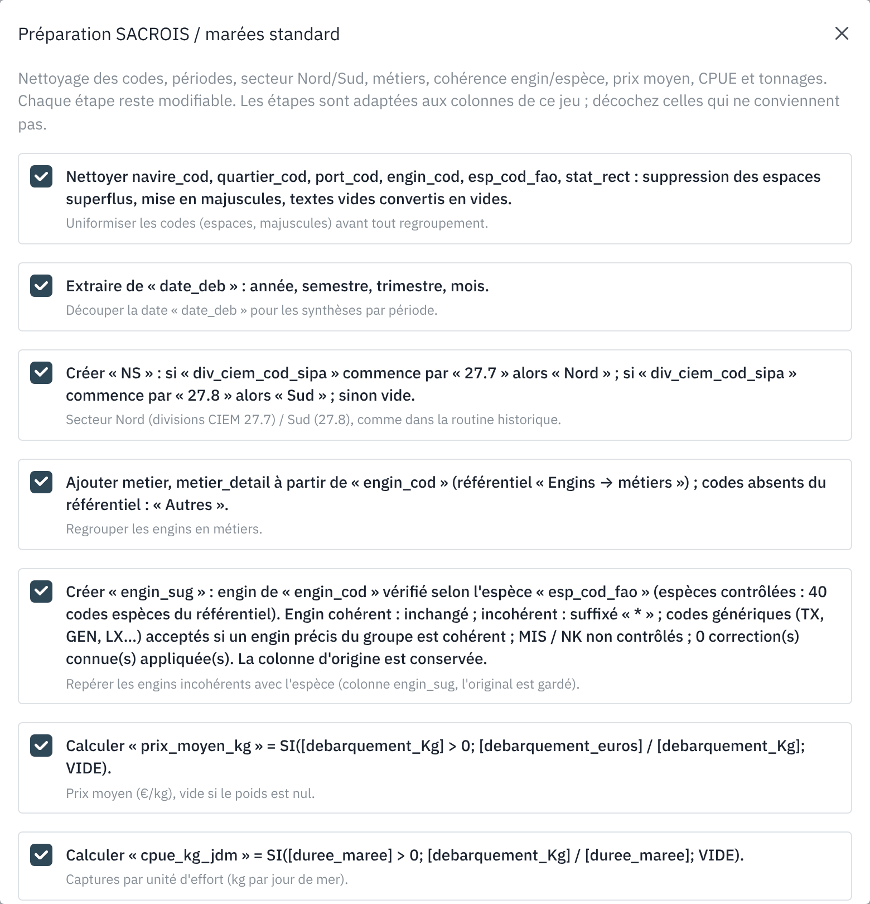

Tableau : Étapes du modèle SACROIS
| Étape | Colonnes produites | Rôle |
|---|---|---|
| Nettoyer les codes | (en place) | Espaces et majuscules uniformisés avant tout regroupement |
| Extraire de la date | `date_deb_annee`, `…_semestre`, `…_trimestre`, `…_mois` | Synthèses par période |
| Secteur | `NS` | Nord (divisions CIEM 27.7) / Sud (27.8) |
| Métiers | `metier`, `metier_detail` | Regroupement des engins en métiers |
| Cohérence engin / espèce | `engin_sug` | Engins improbables pour l'espèce marqués d'une `*` |
| Prix moyen | `prix_moyen_kg` | Valeur / poids, vide si le poids est nul |
| CPUE | `cpue_kg_jdm` | Kilos par jour de mer |
| Tonnages | `debarquement_t` | Plus lisible dans les graphiques |

### 6.2. Cohérence engin / espèce et corrections

L'étape *Cohérence engin / espèce* compare chaque couple espèce / engin à une liste d'engins cohérents, établie à partir de la littérature (FAO ISSCFG 2016, CIEM, Ifremer) pour 26 espèces de Manche et du golfe de Gascogne. Les codes génériques (TX, GEN, LX…) sont acceptés si un engin précis du groupe est cohérent. L'engin d'origine est conservé ; la colonne `engin_sug` reçoit l'engin vérifié, suffixé d'une `*` s'il est incohérent.

*Charger les incohérences du jeu* liste les combinaisons navire / espèce / engin suspectes. Pour chacune, indiquez l'engin réel : ces **corrections connues** sont enregistrées dans la recette et donc dans la fiche méthode. Elles s'exportent et s'importent en CSV (`navire ; espece ; engin_declare ; engin_corrige`), ce qui permet de réutiliser les corrections d'une année sur l'autre.

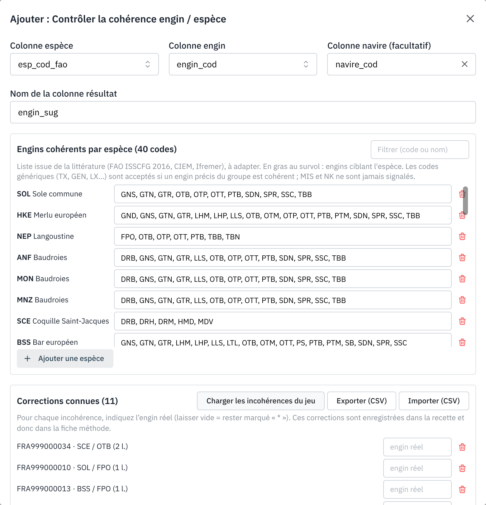

### 6.3. Le contrôle qualité

L'onglet **Contrôle qualité** est calculé sur le résultat de la recette : valeurs vides, valeurs très éloignées du reste (au-delà de trois écarts interquartiles), puis un tableau par colonne (type, vides, valeurs distinctes, minimum, maximum, moyenne, médiane, valeurs les plus fréquentes). Ce sont des signaux à vérifier, pas forcément des erreurs.

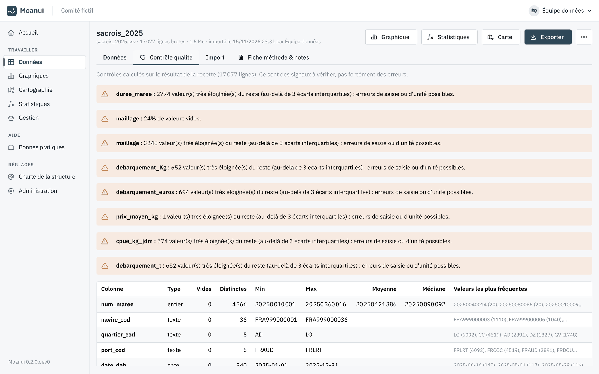

## 7. Regrouper, associer, empiler

### 7.1. Associer un autre jeu (jointure)

*Associer un autre jeu* ajoute aux lignes du jeu actuel les informations d'un autre jeu, par une ou plusieurs colonnes de correspondance : par exemple le nom commun et le groupe d'une espèce depuis un référentiel, ou la longueur et la puissance des navires depuis le fichier flotte. Les colonnes de même nom sont proposées automatiquement comme clés.

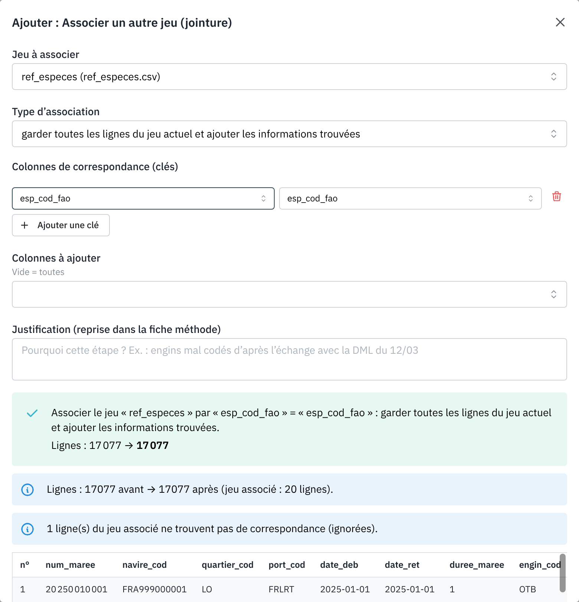

Avant validation, Moanui indique le nombre de lignes avant et après et signale les clés sans correspondance ou les associations qui dupliqueraient des lignes (une clé présente plusieurs fois dans l'autre jeu).

Tableau : Types d'association
| Type | Lignes conservées | Usage |
|---|---|---|
| Garder toutes les lignes du jeu actuel et ajouter les informations trouvées | Toutes celles du jeu actuel | Le plus courant : enrichir sans rien perdre |
| Garder uniquement les lignes présentes dans les deux jeux | Lignes communes | Travailler sur des données complètes |
| Garder toutes les lignes des deux jeux | Toutes | Comparer deux sources |
| Garder toutes les lignes de l'autre jeu | Toutes celles de l'autre jeu | Partir du référentiel |
| Garder les lignes du jeu actuel sans correspondance | Lignes orphelines | Trouver les codes inconnus |
| Garder les lignes du jeu actuel avec correspondance | Lignes reconnues, sans colonnes ajoutées | Filtrer par une liste |

### 7.2. Empiler d'autres jeux

*Empiler d'autres jeux* ajoute sous le jeu actuel les lignes d'autres jeux (plusieurs années, plusieurs fichiers mensuels). Les colonnes sont associées par leur nom ; une colonne de provenance peut indiquer de quel fichier vient chaque ligne. Moanui signale les colonnes absentes d'un fichier et, surtout, les **différences d'ordre de grandeur** : dans l'exemple, un fichier saisi en tonnes au lieu de kilos est repéré avant l'empilement.

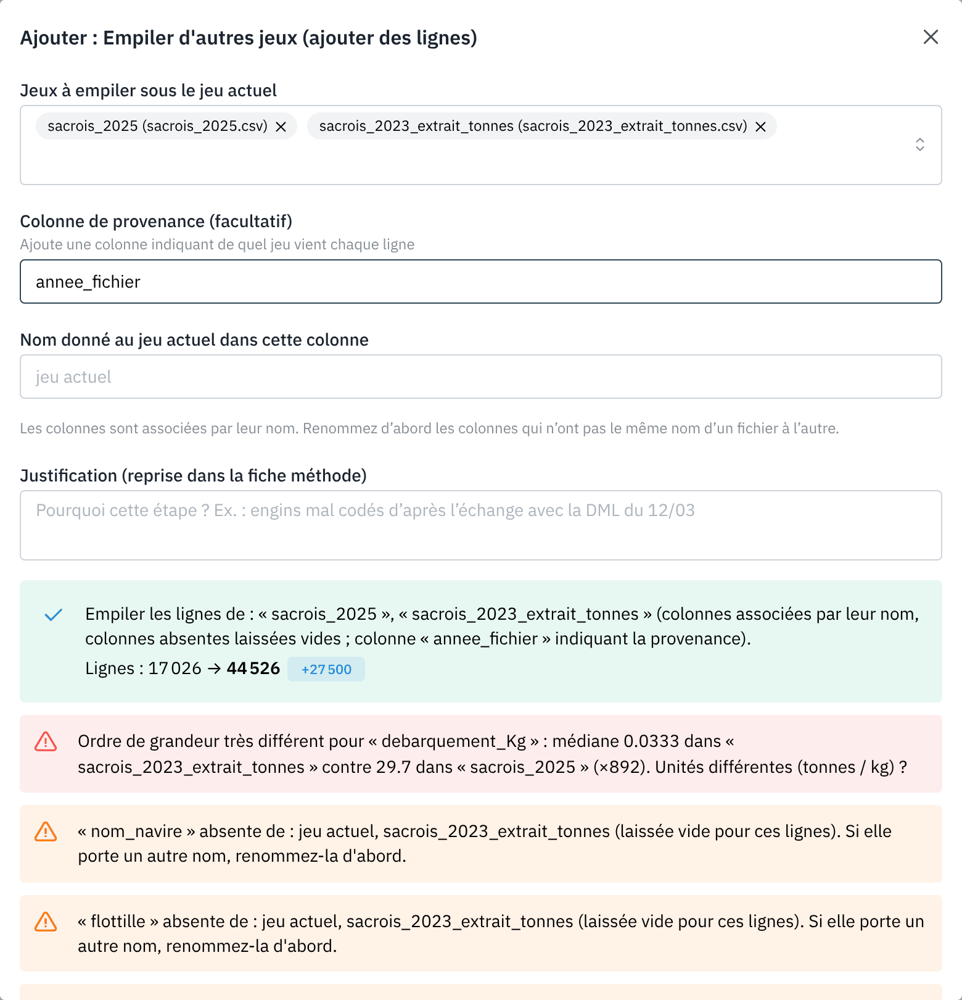

### 7.3. Regrouper et résumer, secret statistique

*Regrouper et résumer* calcule des sommes, moyennes, médianes, minimums, maximums, nombres de valeurs, de lignes ou de valeurs distinctes (par exemple le nombre de navires) par groupe. L'option **secret statistique** ajoute le nombre de navires de chaque groupe et masque les résultats des groupes de moins de trois navires (seuil réglable), conformément à la loi n° 51-711 sur le secret statistique.

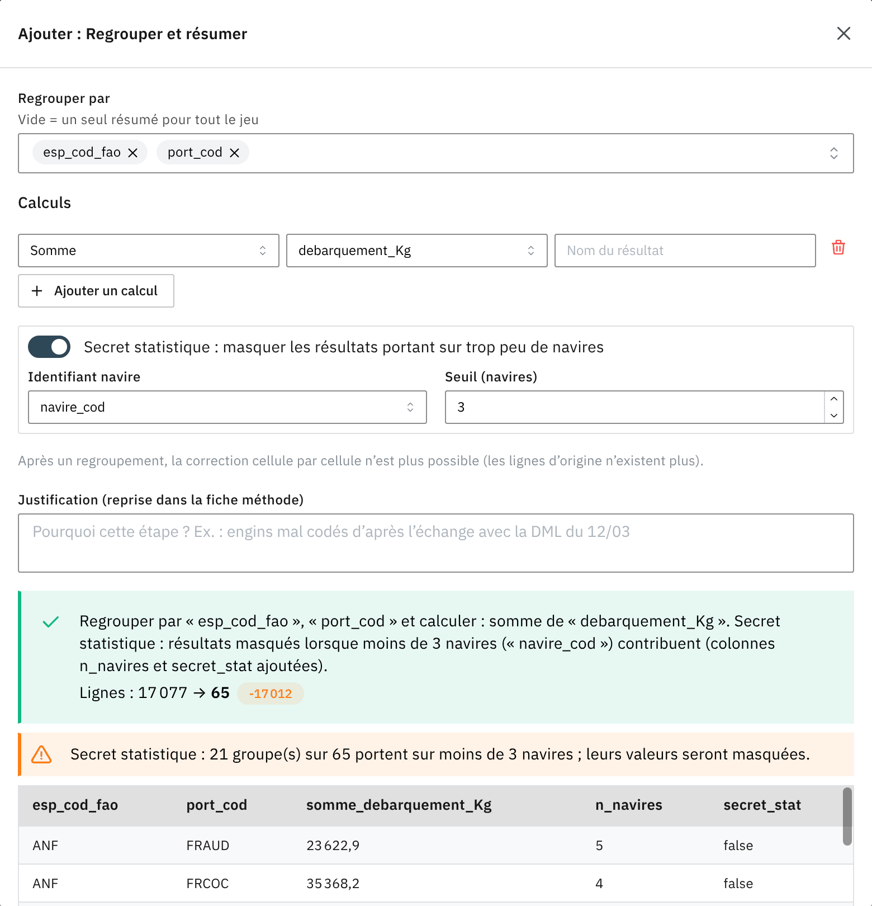

## 8. Exporter et documenter

### 8.1. Exporter les données

*Exporter* télécharge le résultat de la recette (jamais le fichier brut modifié) en CSV compatible Excel français (point-virgule, virgule décimale), en Excel ou en Parquet (pour R ou Python). La fiche méthode est jointe à l'export. L'option *Inclure le numéro de ligne d'origine* permet de retrouver chaque ligne dans le fichier brut.

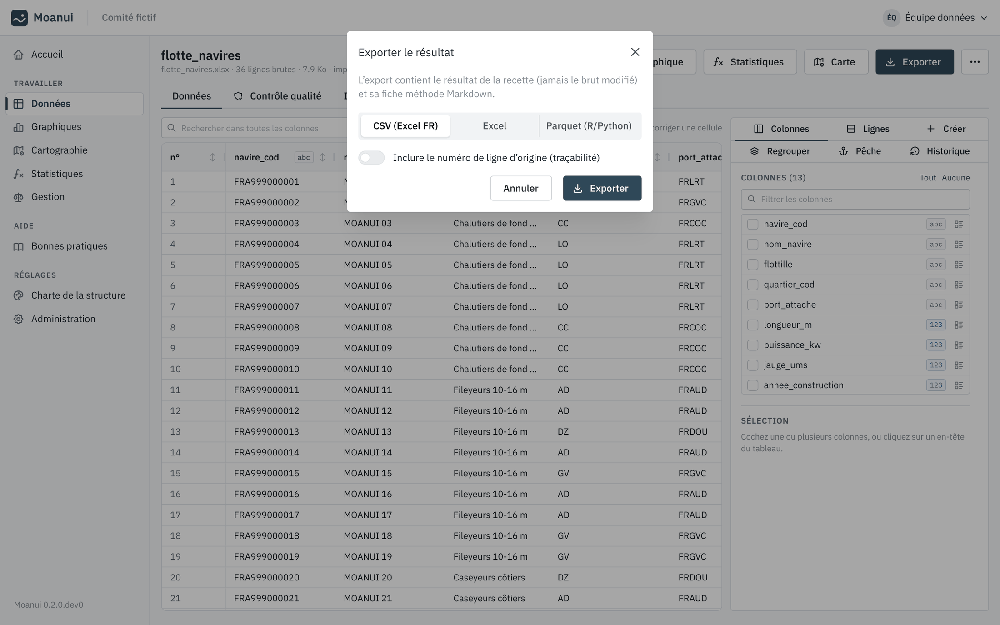

Si le jeu contient des colonnes sensibles non anonymisées, un avertissement les liste. Vous pouvez exporter pour un usage interne ; pour une diffusion, ajoutez d'abord une étape *Anonymiser* (onglet Pêche) : codes, hachage ou suppression des colonnes.

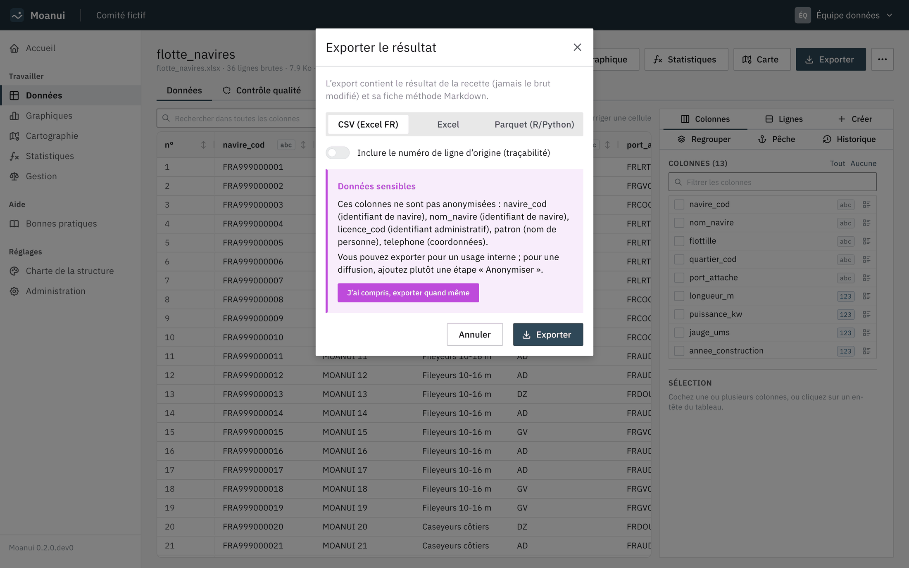

### 8.2. La fiche méthode du jeu

L'onglet **Fiche méthode & notes** affiche la fiche du jeu, construite automatiquement : sources (fichier, empreinte, options de lecture, types reconnus), traitements dans l'ordre avec leurs justifications et le nombre de lignes après chaque étape, méthodes employées avec leurs références, données obtenues, confidentialité, et la requête qui refait le calcul. Les **notes libres** (contexte, limites connues, échanges avec les fournisseurs) y sont reprises.

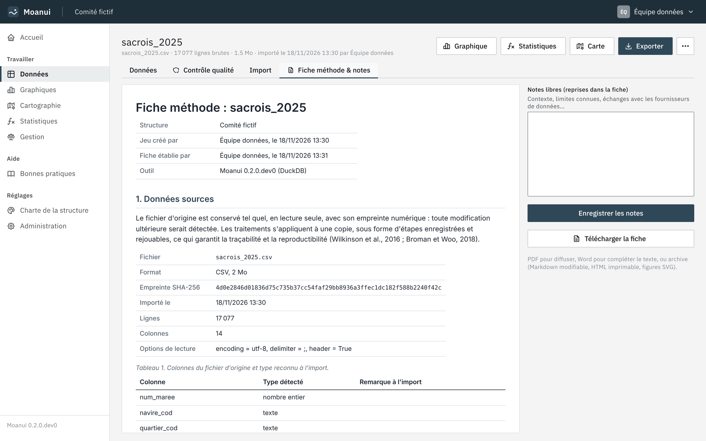

Le bouton **Télécharger la fiche** propose trois formats.

Tableau : Formats des fiches méthode
| Format | Usage |
|---|---|
| PDF | À diffuser ou imprimer ; mise en page, figures, tableaux et références intégrés |
| Word (.docx) | À compléter ou intégrer à un rapport ; titres, légendes et figures numérotés |
| Archive (zip) | Markdown modifiable, HTML imprimable et figures en SVG |

Les mêmes formats existent pour les fiches des graphiques, des cartes, des analyses statistiques et des suivis de gestion. Les polices et figures sont intégrées : le rendu est identique sur tous les postes, sans Word ni logiciel à installer.

Les fiches PDF et Word suivent les usages des rapports scientifiques et institutionnels :

- un **bandeau** indique l'organisme (la structure active) et la nature du document ;
- un **bloc documentaire** en tête donne l'organisme, le jeu de données, l'auteur, la date et la version du logiciel ;
- la ligne **Pour citer ce document** donne la référence à reprendre (organisme, année, titre, nature du document), sur le modèle des rapports du CIEM ;
- légende des tableaux au-dessus, légende des figures en dessous, numérotation continue, une seule liste de références en fin de document ;
- typographie française : espace insécable avant les deux-points, le point-virgule et le signe %, entre un nombre et son unité, vrai signe moins (−0,14) ;
- un titre de section n'est jamais laissé seul en bas de page, et chaque page porte l'organisme et sa pagination (« 3 / 6 »).

Moanui n'invente aucune métadonnée : pas de numéro de rapport ni de niveau de diffusion, à ajouter dans la version Word si votre structure en utilise.

L'onglet **Import** rappelle à tout moment l'empreinte du fichier brut, les options de lecture et le type reconnu pour chaque colonne.

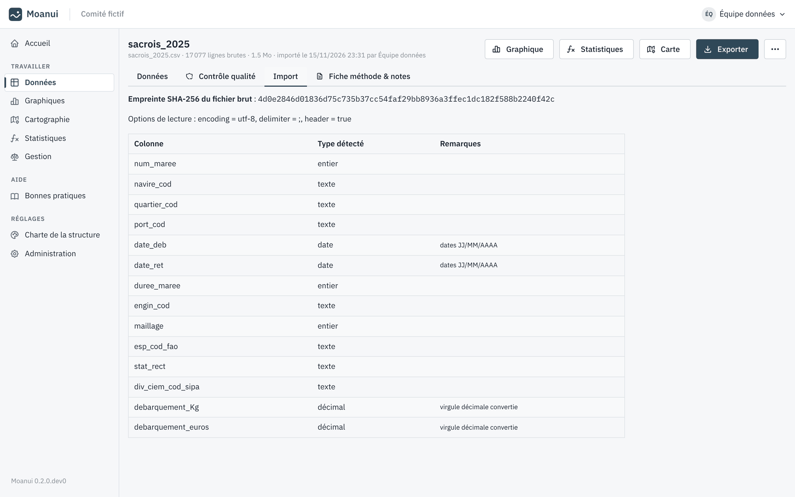

# Partie 3 : Représenter les données

## 9. Créer un graphique

### 9.1. L'interface

La page **Graphiques** se compose du panneau de réglages à gauche et du graphique à droite. Choisissez le jeu de données, le type de graphique, puis les données représentées : axe horizontal, mesures (agrégat et colonne), couleur ou séries, petits multiples. Le graphique se met à jour à chaque réglage.

Sous le type, le sélecteur **Simple / Avancé** règle le nombre d'options affichées :

- en **Simple** (par défaut), l'essentiel pour un graphique propre : données, séries (côte à côte, empilé ou 100 %), petits multiples, filtres, titre et source ;
- en **Avancé**, tous les réglages : forme, axe et couleur de chaque mesure, axes et échelles, repères et annotations, mise en page.

Passer d'un mode à l'autre ne change rien au graphique : le mode simple masque des réglages, il ne les efface pas. L'appli retient le mode choisi sur ce poste.

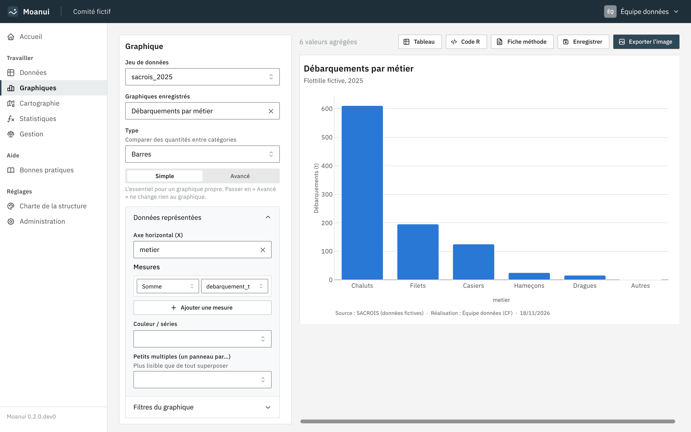

Les données sont calculées sur le résultat de la recette du jeu. Les **filtres du graphique** ne concernent que ce graphique et sont indiqués dans sa fiche méthode. Le bouton *Tableau* affiche les chiffres représentés.

Tableau : Types de graphiques
| Type | Usage conseillé |
|---|---|
| Barres, barres horizontales | Comparer des quantités entre catégories ; noms longs et classements |
| Courbes | Évolution dans le temps |
| Aires | Évolution d'un total et de sa composition |
| Barres + courbes | Plusieurs mesures, plusieurs axes possibles |
| Anneau | Parts d'un tout (six catégories au plus) |
| Carte de chaleur | Deux dimensions croisées (mois × espèce…) |
| Nuage de points, bulles | Relation entre deux mesures (et une troisième en taille) |
| Boîtes à moustaches, violons, histogramme | Distribution d'une mesure, par groupe ou non |
| Nuage 3D, surface 3D | Exploration de trois variables |

Des **conseils de lecture** s'affichent au-dessus du graphique : source manquante, axe des barres qui ne part pas de zéro, plus de six parts dans un anneau, échelle logarithmique à signaler, plusieurs axes verticaux.

### 9.2. Mesures, formes et axes multiples

Les réglages de cette section et des deux suivantes sont en mode **Avancé**. Chaque mesure se règle indépendamment : forme (barres, courbe, aire ou points), **axe** (gauche, droit, second gauche, second droit), couleur de la palette de la structure, tirets et valeurs affichées. On peut ainsi superposer jusqu'à **quatre axes verticaux**, chacun avec sa propre échelle : par exemple des tonnages en barres, une valeur en euros en courbe et un prix moyen en points.

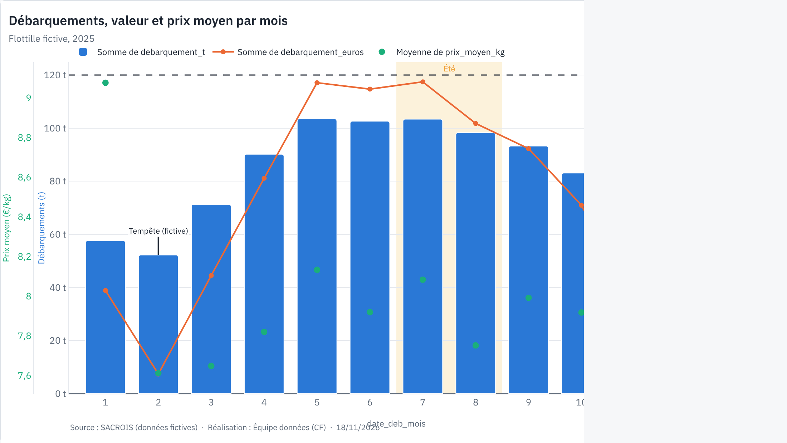

Dans *Axes et échelles*, chaque axe a son titre, son échelle (linéaire ou logarithmique), ses bornes et son unité (« t », « € », « % »). Quand plusieurs axes sont utilisés, le titre de chaque axe prend la couleur de sa mesure, pour que le lecteur sache quelle courbe lire sur quel axe. Les barres placées sur des axes différents sont disposées côte à côte.

> **Plusieurs axes : avec modération.** Deux échelles différentes sur un même graphique peuvent suggérer un lien qui n'existe pas. Donnez toujours un titre et une unité à chaque axe ; pour un public large, préférez des petits multiples.

### 9.3. Repères et annotations

*Repères et annotations* ajoute des éléments de lecture :

- une **ligne horizontale** (seuil, quota, moyenne de référence), sur l'axe de votre choix ;
- une **ligne sur une catégorie** (date d'une décision, d'un événement) ;
- une **zone entre deux catégories** (période de fermeture, saison) ;
- une **note** avec flèche sur une catégorie (tempête, changement de réglementation).

### 9.4. Mise en page

*Mise en page* propose des formats prêts à l'emploi (rapport pleine largeur, page A4 paysage ou portrait, diapositive 16:9, carré pour les réseaux sociaux, bandeau), la position de la légende (en haut, à droite, en bas ou masquée) et le nombre de décimales des infobulles et valeurs.

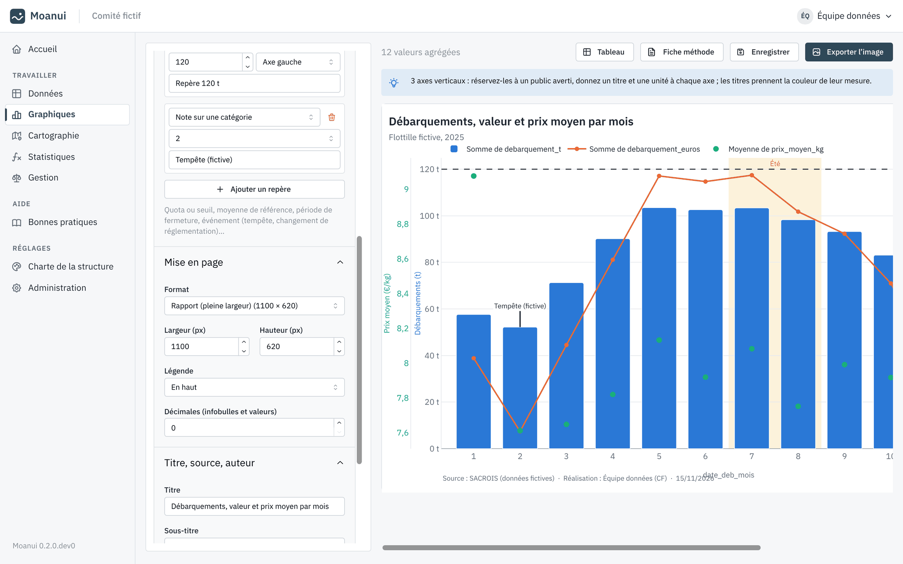

*Titre, source, auteur* complète le gabarit : titre, sous-titre (périmètre, période, unité), source (obligatoire pour une diffusion), auteur, note de lecture, date et logo de la structure.

### 9.5. Petits multiples

*Petits multiples* découpe le graphique en un panneau par valeur d'une colonne (métier, port, année). Les panneaux peuvent partager une **échelle commune**, pour comparer les hauteurs d'un panneau à l'autre, ou avoir des échelles indépendantes, pour comparer les formes. Le nombre de panneaux par ligne est réglable.

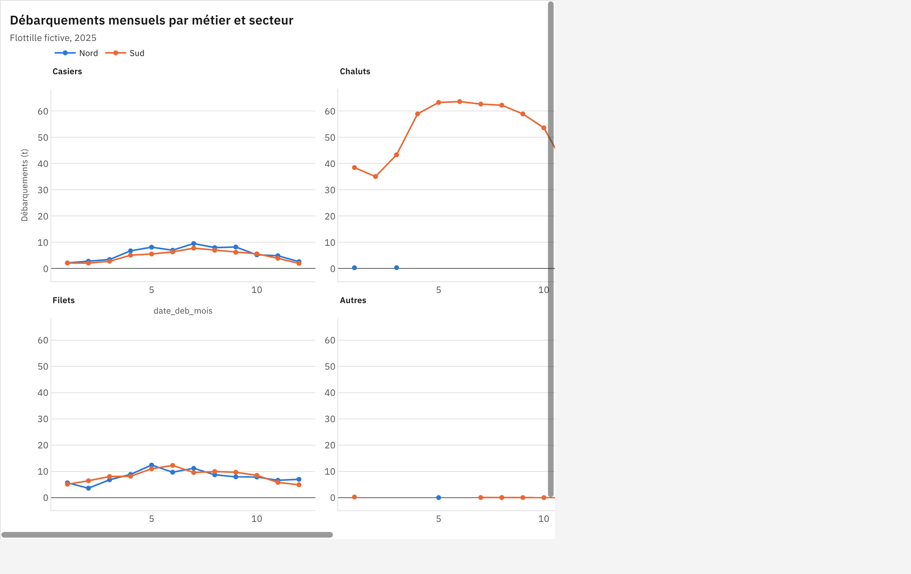

### 9.6. Distributions

Les boîtes à moustaches, violons et histogrammes représentent les valeurs brutes (et non des agrégats). L'échelle logarithmique est utile pour des prix ou des captures très asymétriques ; elle est signalée dans les conseils et dans la fiche.

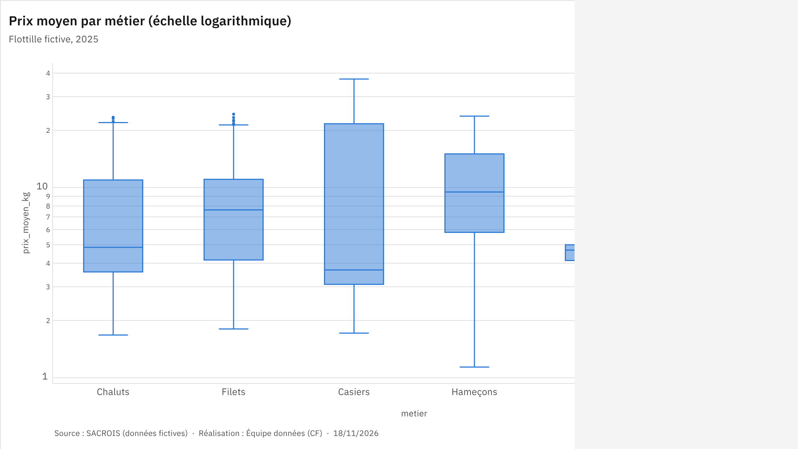

## 10. Enregistrer et exporter un graphique

*Enregistrer* conserve le graphique (dans le jeu de données) pour le retrouver dans *Graphiques enregistrés* et sur la page d'accueil. *Exporter l'image* produit un PNG haute définition ou un SVG vectoriel, retouchable. *Fiche méthode* produit la fiche du graphique en PDF, Word ou archive : ce qui est représenté (type, axes, mesures, repères), le calcul et la justification du choix de représentation, avec le graphique lui-même.

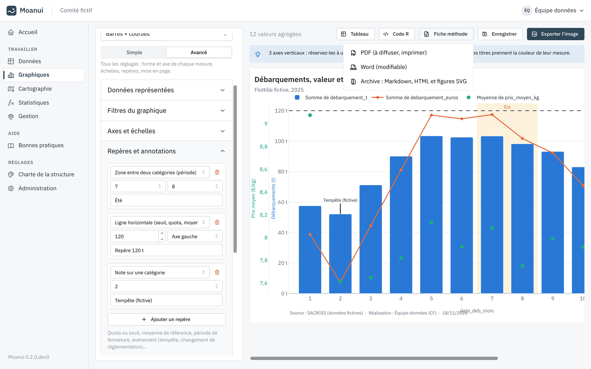

### 10.1. Code R équivalent

Le bouton **Code R** affiche le même graphique écrit en R (paquet ggplot2), comme dans la version 0.1 de l'outil. Le script reprend le type, les séries, les axes, les repères, les couleurs de la charte, le titre et la source, puis enregistre l'image en PNG. *Télécharger le script et les données* produit une archive avec le script, les données du graphique en CSV (après recette et filtres, exactement celles affichées) et un mode d'emploi : il suffit de l'ouvrir dans RStudio et de le lancer.

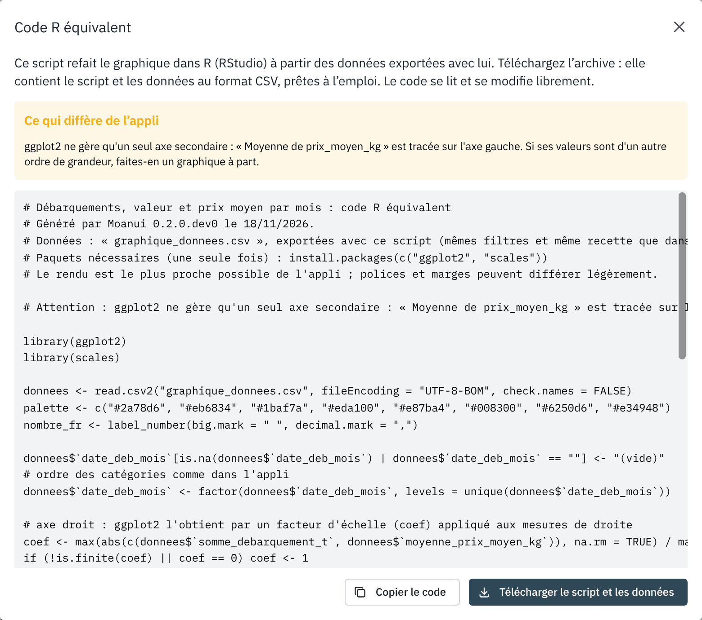

Ce que ggplot2 ne sait pas faire à l'identique est signalé en tête du script : il ne gère qu'un seul axe secondaire (les mesures placées sur un deuxième axe gauche ou droit sont ramenées sur l'axe principal correspondant), et la 3D passe par le paquet plotly. Le code se lit, se copie et se modifie librement : c'est le point de départ pour aller plus loin que l'appli.

# Partie 4 : Cartographie et VMS

## 11. Réaliser une carte

### 11.1. L'interface

La page **Cartographie** comprend la liste des couches à gauche (ordre d'affichage, visibilité, centrage, style, suppression), le fond de carte et la mise en page en bas, et la carte à droite avec sa légende, son échelle en milles et son titre.

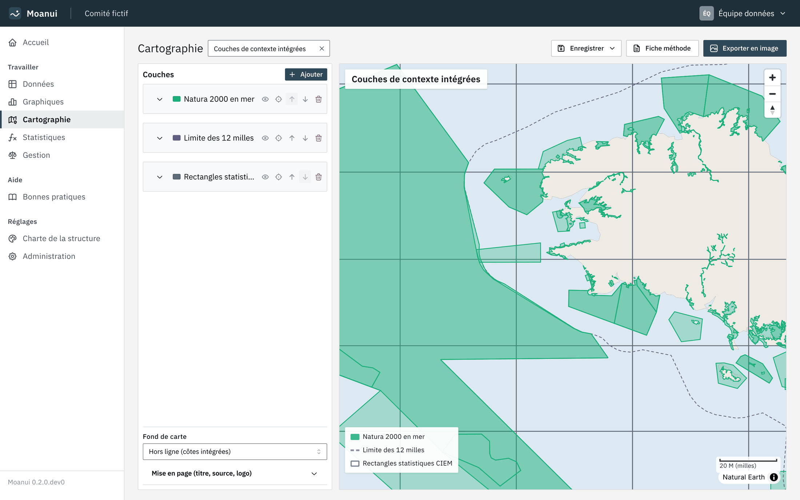

Tableau : Fonds de carte
| Fond | Remarque |
|---|---|
| Plan IGN | En ligne (Géoplateforme), sans clé |
| OpenStreetMap | En ligne |
| Hors ligne | Côtes intégrées à l'application (Natural Earth), toujours disponible |
| Aucun | Fond blanc, pour l'export |

### 11.2. Ajouter des couches

Le bouton **Ajouter** propose trois sources : une couche de contexte ou importée, les données d'un jeu (positions, carroyage, rectangles CIEM), ou l'import d'une nouvelle couche.

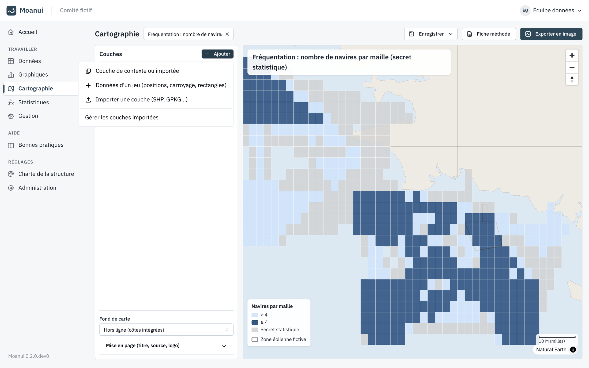

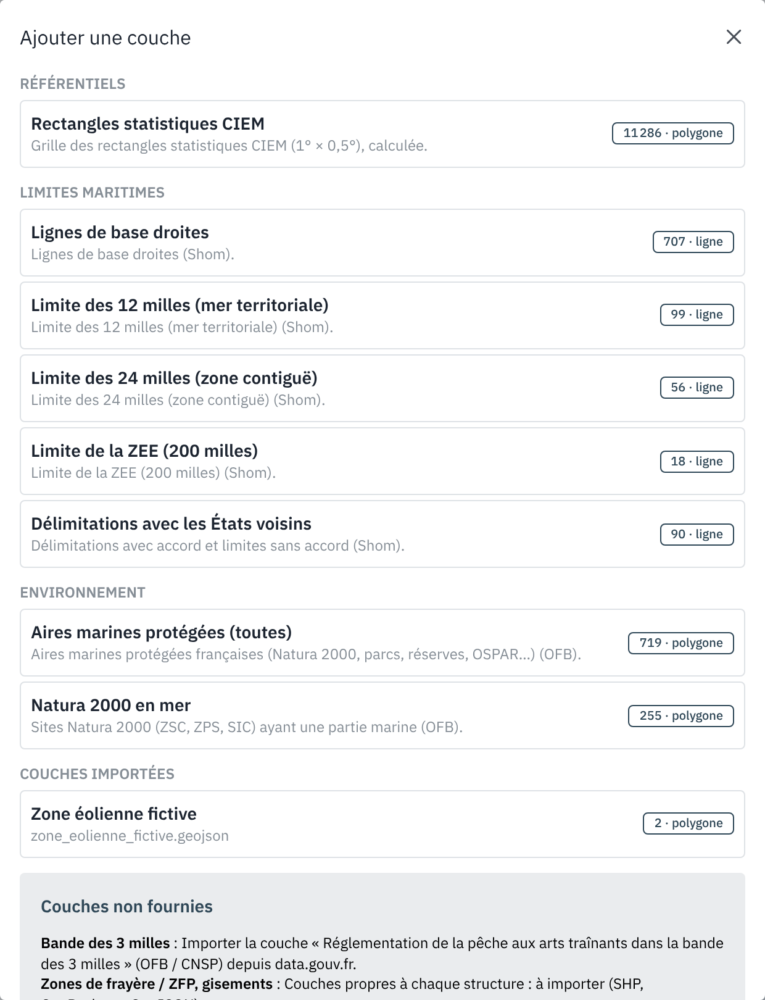

Tableau : Couches de contexte intégrées
| Couche | Source |
|---|---|
| Rectangles statistiques CIEM | Calculés (grille de 1° × 0,5°) |
| Lignes de base droites, limites des 12 et 24 milles, ZEE, délimitations | Shom |
| Aires marines protégées, Natura 2000 en mer | Office français de la biodiversité |
| Terres (fond hors ligne) | Natural Earth |

Les couches importées acceptent le Shapefile (zip ou fichiers), le GeoPackage (plusieurs couches possibles), le GeoJSON et le KML. Le fichier d'origine est conservé ; la couche est reprojetée automatiquement en WGS84 (un Shapefile en Lambert-93 s'affiche directement au bon endroit). La bande des 3 milles et les zones propres à chaque structure (frayères, gisements) sont à importer.

Chaque couche se style par une couleur unique ou **selon un attribut** (catégories ou classes), avec opacité, épaisseur, pointillés, taille des points et zoom d'apparition.

### 11.3. Exporter

*Exporter en image* compose une image avec le titre, la légende, l'échelle, le nord, la source et le logo. *Fiche méthode* décrit les couches, leurs sources et licences, la projection et les méthodes (classes, carroyage, secret statistique). *Enregistrer* conserve la carte pour la structure.

## 12. Données VMS

### 12.1. Préparer un fichier VMS

Dans l'onglet **Pêche** d'un jeu de positions, *Préparation VMS (Agiltech, CLS…)* harmonise les fichiers des deux fournisseurs : noms de colonnes (`lat`, `lon`, `date_heure`, `navire`, `vitesse_nds`), vitesse CLS convertie (SP en dixièmes de nœud), puis calcule l'activité et le rectangle CIEM de chaque position. Les fichiers Agiltech et CLS préparés peuvent ensuite être empilés.

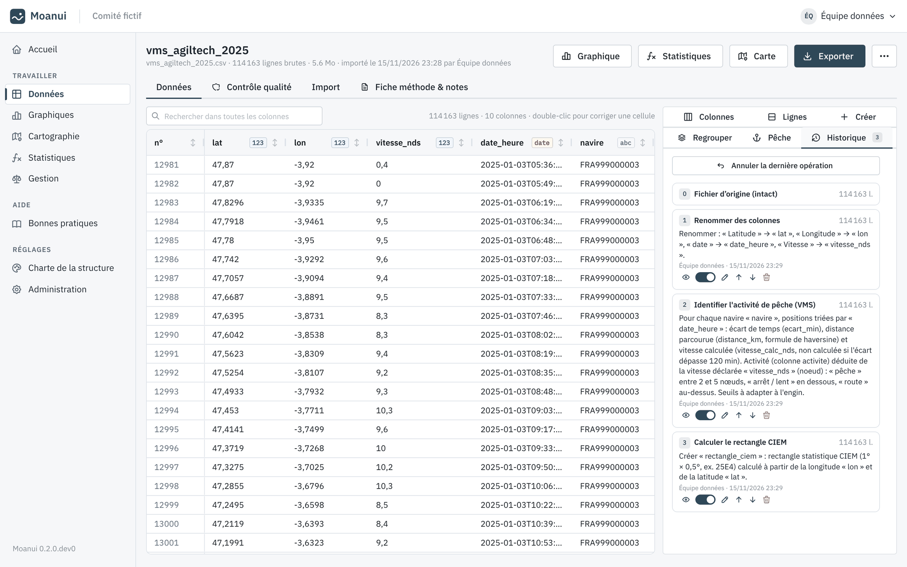

Tableau : Différences entre les formats VMS
| Élément | Agiltech | CLS |
|---|---|---|
| Position | `Latitude`, `Longitude` | `LT`, `LG` |
| Vitesse | `Vitesse` en nœuds | `SP` en dixièmes de nœud (0 à 100) |
| Date | `jj/mm/aaaa hh:mm` | `aaaa-mm-jj hh:mm:ss` |
| Navire | `navire` | `OP` |

*Identifier l'activité de pêche* calcule pour chaque navire l'écart de temps, la distance et la vitesse entre positions, puis classe chaque position en « pêche », « route » ou « arrêt / lent » selon des **seuils de vitesse propres à l'engin** (par défaut ceux du chalut de fond, de 2 à 5 nœuds ; à adapter pour les fileyeurs ou les dragueurs). Les sauts impossibles (plus de 25 nœuds entre deux positions, erreurs GPS) et les horodatages en double sont signalés.

### 12.2. Cartes de positions et de fréquentation

*Données d'un jeu* affiche les positions sur la carte, ou les agrège en **carroyage** (mailles de taille réglable, 0,05° ≈ 3 milles en latitude) ou par **rectangle CIEM** : nombre de positions, de navires ou somme d'une colonne. Le secret statistique masque (en gris) les mailles de moins de trois navires.

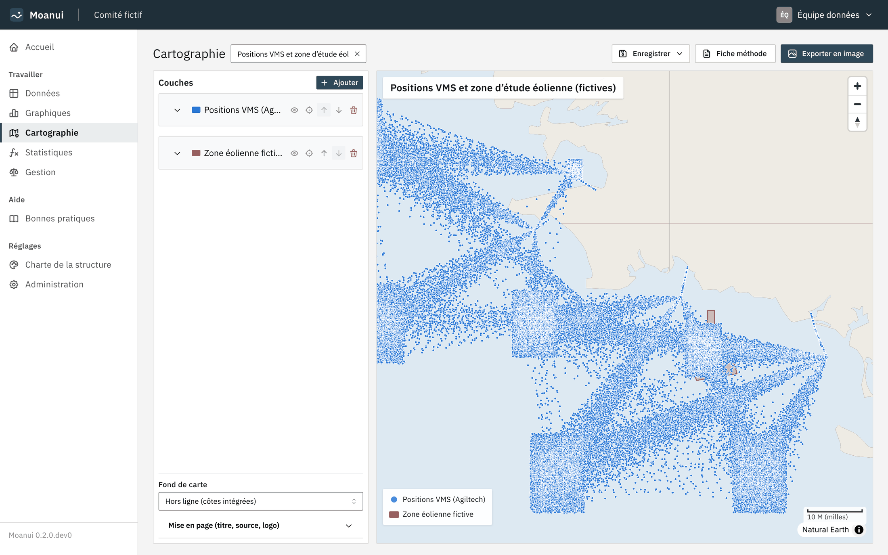

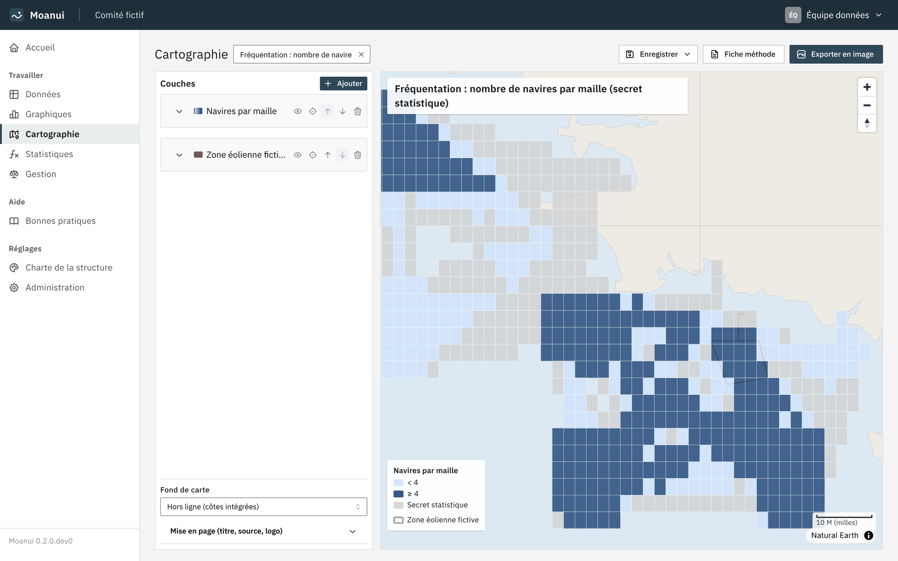

### 12.3. Repérer les positions dans une zone

*Repérer les positions dans une zone* (onglet Pêche) ajoute à chaque position la zone qui la contient : Natura 2000, 12 milles, zone d'un projet éolien ou toute couche importée. On peut ensuite filtrer, regrouper ou cartographier l'activité dans la zone.

### 12.4. Répartir les captures sur les positions (VMS × SACROIS)

*Répartir les captures sur les positions* répartit les captures déclarées d'un navire et d'un jour sur ses positions de pêche du même jour, et du même rectangle CIEM quand il est disponible, à parts égales ou au prorata du temps passé. Le résultat compte une ligne par position et par espèce, prête pour la carte : il permet par exemple d'estimer la valeur pêchée dans une zone de projet.

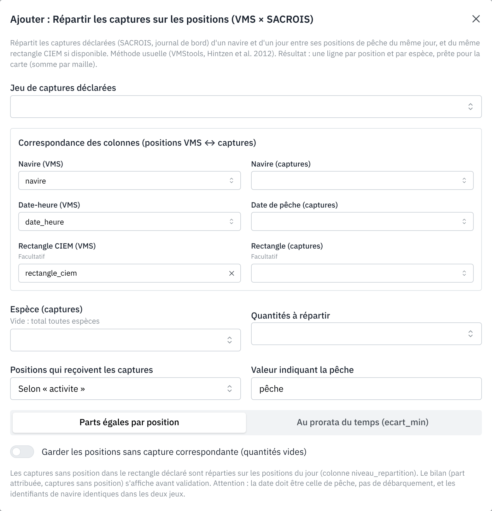

Avant validation, un bilan indique la part des captures attribuée (au niveau du rectangle ou du jour) et la part non attribuée, avec ses causes possibles : navires sans VMS (moins de 12 m), identifiants différents entre les deux jeux, seuils de vitesse trop stricts, date de débarquement au lieu de la date de capture.

> **Limite.** Le VMS ne couvre que les navires de 12 m et plus : l'activité des petits navires n'apparaît pas sur ces cartes. Les comités le rappellent dans les débats sur l'éolien en mer ; complétez si possible par des enquêtes de terrain.

# Partie 5 : Statistiques

## 13. Analyses statistiques

### 13.1. Choisir sa question (mode guidé)

La page **Statistiques** a deux modes, au choix en haut du panneau : **Guidé** (par défaut) et **Expert** (section 13.6).

En mode guidé, tout part d'une question, et non d'un nom de test, en trois étapes numérotées : *1. Quelle est votre question ?*, *2. Quelles colonnes ?*, *3. Lancer l'analyse*. Une fois les colonnes choisies, Moanui reformule la question en une phrase (« Vous demandez si « cpue_kg_jdm » diffère d'un groupe à l'autre de « metier » »), ce qui permet de vérifier qu'on pose la bonne. Moanui vérifie ensuite les conditions d'application, choisit le test adapté et, si une condition n'est pas remplie, bloque en proposant une alternative.

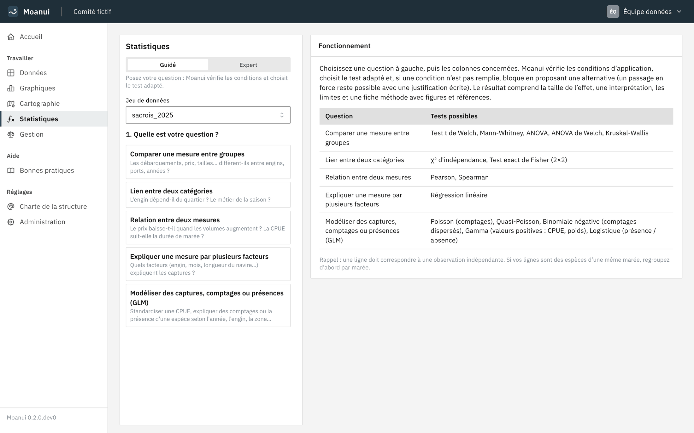

Tableau : Questions et tests
| Question | Tests |
|---|---|
| Comparer une mesure entre groupes | t de Welch, Mann-Whitney, ANOVA, ANOVA de Welch, Kruskal-Wallis (comparaisons deux à deux corrigées, par Holm par défaut) |
| Lien entre deux catégories | χ² d'indépendance, test exact de Fisher (2 × 2) |
| Relation entre deux mesures | Pearson, Spearman |
| Expliquer une mesure par plusieurs facteurs | Régression linéaire |
| Modéliser des captures, comptages ou présences | GLM Poisson, quasi-Poisson, binomiale négative, Gamma, logistique |

*Pas à pas* explique la démarche de chaque question ; *Restreindre les données* applique des filtres propres à l'analyse.

### 13.2. Conditions, résultats et interprétation

Le résultat commence par *Ce qu'il faut retenir* (interprétation en langage clair), puis les **conditions vérifiées** (effectifs, normalité, égalité des variances…, avec leur statut), les chiffres clés, l'**écriture normalisée** (statistique, degrés de liberté, p exacte, taille d'effet et son intervalle de confiance à 95 %, à reprendre telle quelle dans un rapport), le graphique, les tableaux, la **discussion** et les limites.

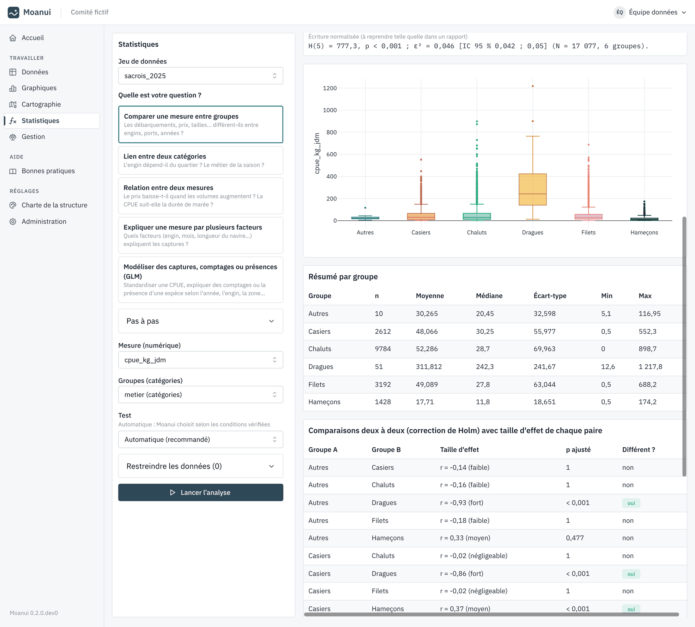

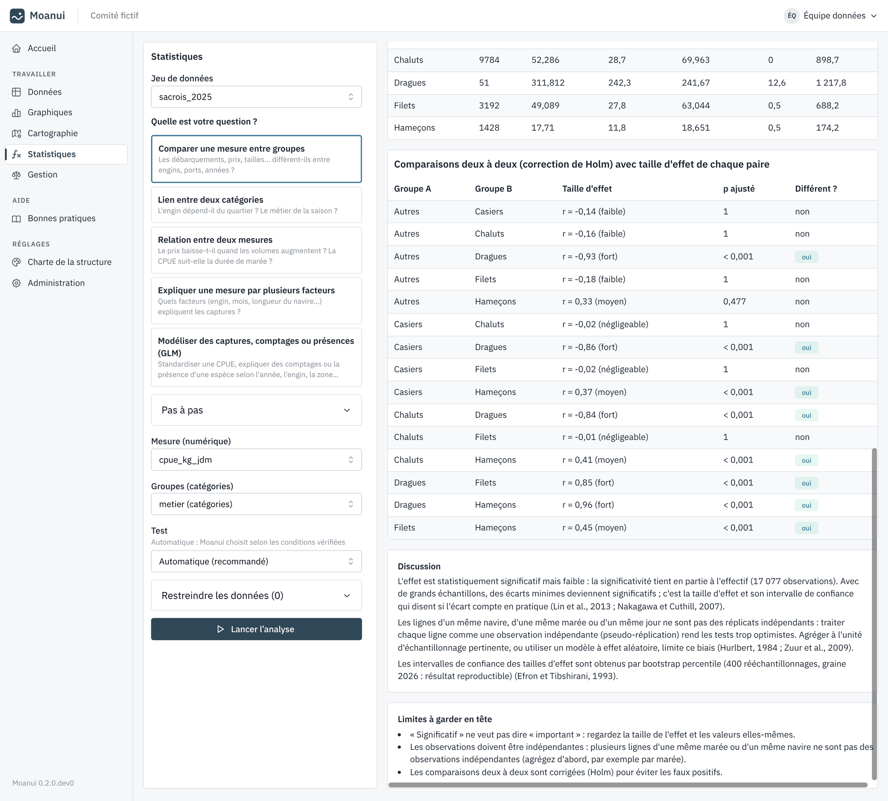

La discussion dépend des résultats : un effet significatif mais faible sur un grand échantillon est signalé comme tel ; l'absence de significativité est présentée comme une absence de preuve, pas comme une preuve d'absence ; la pseudo-réplication (plusieurs lignes d'un même navire ou d'une même marée) est rappelée. Les intervalles de confiance sans formule sont estimés par bootstrap, avec une graine fixe : refaire l'analyse donne exactement le même résultat.

### 13.3. Analyse bloquée

Quand une condition bloquante n'est pas remplie, les résultats ne s'affichent pas : Moanui explique le problème et propose une alternative en un clic. Vous pouvez aussi **passer outre**, à condition d'écrire une justification, reprise dans la fiche méthode.

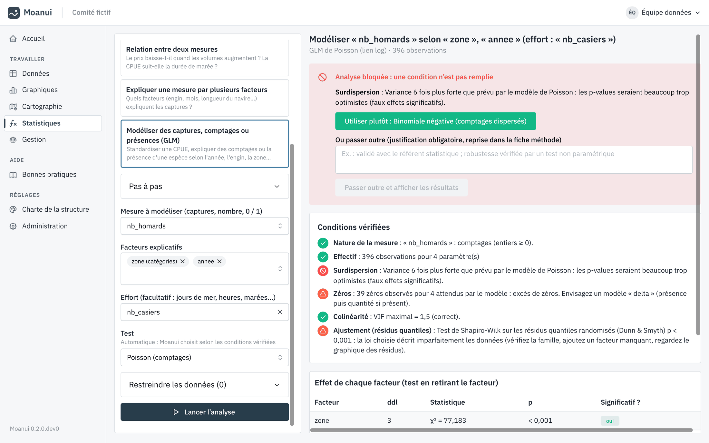

### 13.4. Modèles de captures (GLM) et indice standardisé

Le GLM modélise des captures, des comptages ou des présences selon des facteurs (année, zone, engin…). La famille est choisie automatiquement selon la nature de la mesure : 0 / 1 → logistique ; comptages → Poisson, puis binomiale négative en cas de surdispersion ; valeurs positives → Gamma ; zéros et décimales mêlés → blocage avec conseil (modèle « delta »). L'**effort** (jours de mer, nombre de casiers) peut être pris en compte comme décalage : le modèle porte alors sur le rendement, comme pour une standardisation de CPUE.

Le résultat donne l'effet de chaque facteur (test par rapport de vraisemblance), les coefficients en effets multiplicatifs avec leurs intervalles, les contrôles (surdispersion, zéros, colinéarité, résidus quantiles) et l'**indice standardisé** : valeurs prédites par modalité du premier facteur, autres facteurs à leur moyenne.

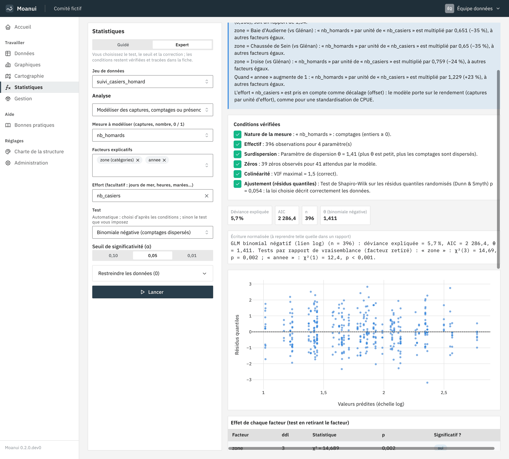

### 13.5. Enregistrer et documenter

*Enregistrer* garde l'analyse dans l'historique du jeu. *Fiche méthode* produit une fiche de niveau « article » : résumé, question et données, méthode et références, conditions, résultats et figures (boîtes, nuage, résidus, diagramme quantile-quantile, indice), interprétation, discussion, limites et reproductibilité (versions, paramètres, seuil, correction, graine).

### 13.6. Mode expert

Le mode **Expert** s'adresse à ceux qui savent quel test ils veulent. L'analyse se choisit dans une liste, et trois réglages apparaissent :

- **Test** : *Automatique* (comme en mode guidé) ou le test que vous imposez ;
- **Seuil de significativité (α)** : 0,10, 0,05 (par défaut) ou 0,01 ;
- **Comparaisons deux à deux** (comparaison de plus de deux groupes) : correction de Holm (par défaut), de Bonferroni, de Benjamini-Hochberg (taux de fausses découvertes) ou aucune.

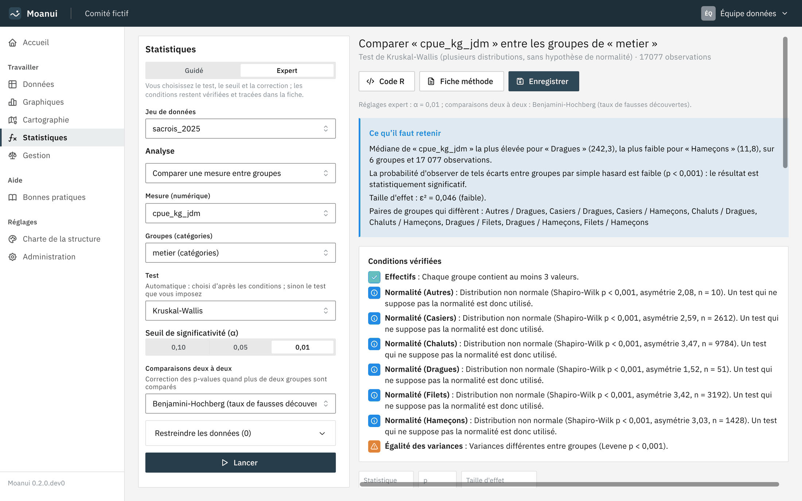

Les conditions d'application restent vérifiées et affichées ; une analyse bloquée le reste, et passer outre demande toujours une justification. Le seuil et la correction choisis changent la décision « significatif ou non », et tous les textes qui en parlent : interprétation, résumé, tableaux, fiche méthode (avec la référence de la correction utilisée). Ils sont rappelés sous le titre du résultat. Le seuil ne concerne que la question posée : les vérifications de conditions gardent leur propre seuil de 5 %.

Le bouton **Code R**, disponible dans les deux modes, donne le script R qui refait l'analyse (même test, même seuil, même correction), avec les lignes utilisées en CSV : tests de base de R (`t.test`, `wilcox.test`, `kruskal.test`, `chisq.test`, `cor.test`, `lm`, `glm`, et `MASS::glm.nb` pour la binomiale négative). Les résultats doivent être identiques à ceux de Moanui, aux arrondis près ; seuls les intervalles obtenus par bootstrap peuvent légèrement différer.

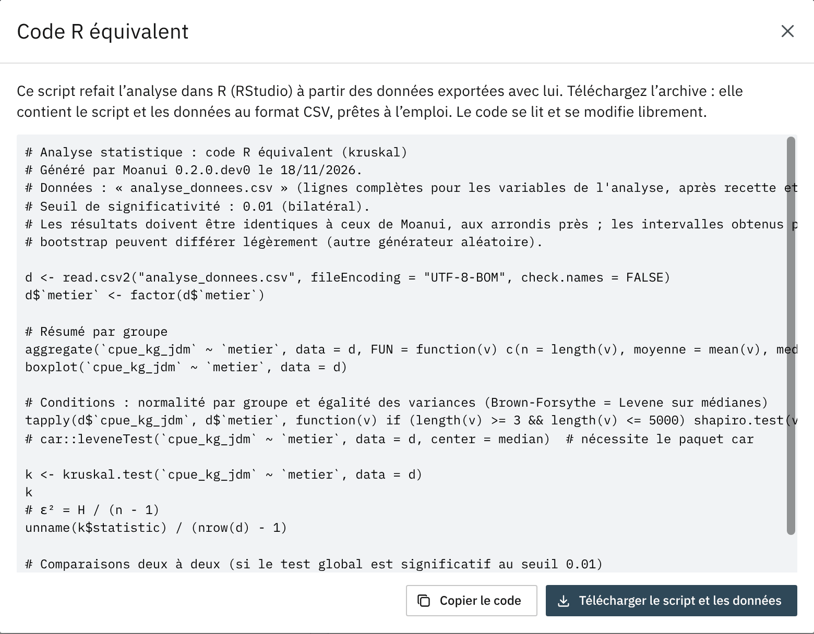

# Partie 6 : Gestion des pêcheries

## 14. Tableau de bord des quotas

La page **Gestion** suit la consommation des quotas et contrôle les limitations de captures, à partir de vos données de débarquement. Le **tableau de bord** affiche tous les quotas enregistrés de la structure : consommation (jauge colorée selon les seuils d'alerte), débarqué face au quota, dernière donnée et projection de fin de période. Cliquer sur une ligne ouvre le suivi détaillé.

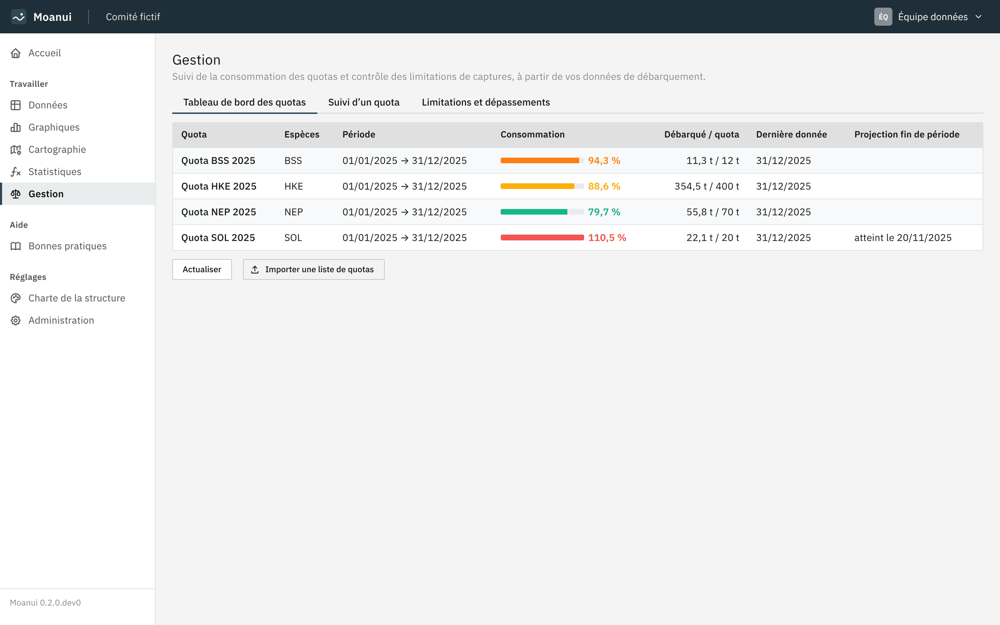

*Importer une liste de quotas* crée plusieurs suivis d'un coup à partir d'un CSV (`esp_cod_fao ; quota_kg ; annonce_kg ; debut ; fin`), après avoir choisi les données dans l'onglet *Suivi d'un quota*.

## 15. Suivi d'un quota

Choisissez les données de captures : les colonnes espèce, date, poids et navire sont proposées automatiquement. Renseignez le nom, les espèces couvertes (codes FAO), la période, le quota en kilos, la consommation annoncée (par exemple par la DGAMPA, pour comparaison) et les seuils d'alerte, puis *Calculer*.

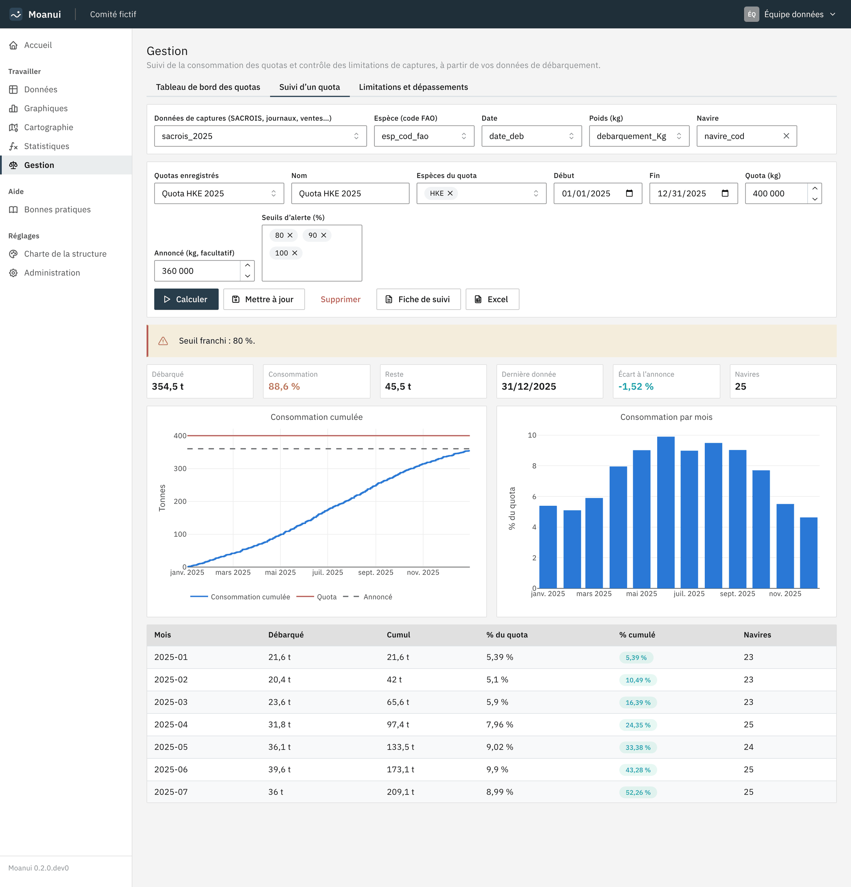

Tableau : Résultats du suivi d'un quota
| Résultat | Signification |
|---|---|
| Débarqué, consommation, reste | Somme des débarquements des espèces du quota dans la période, part du quota, quantité restante |
| Dernière donnée | Date de la dernière débarque prise en compte |
| Écart à l'annonce | Écart entre vos données et la consommation annoncée (négatif = en dessous) |
| Courbe cumulée | Consommation jour par jour, face au quota (rouge) et à l'annonce (tirets) |
| Projection | Prolongement du rythme moyen et du rythme des 30 derniers jours jusqu'à la fin de la période, date estimée d'atteinte |
| Consommation par mois | Part du quota consommée chaque mois, et en cumulé |

> **La projection est une extrapolation.** Elle prolonge un rythme et ne tient compte ni de la saisonnalité, ni des fermetures, ni des échanges de quotas. Les déclarations arrivent avec retard : les dernières semaines sont sous-estimées. Vérifiez aussi que le poids utilisé (vif ou débarqué) et le périmètre (zone, flottille) correspondent à ceux du quota.

*Enregistrer* ajoute le quota au tableau de bord. *Fiche de suivi* produit un document PDF ou Word (résumé, paramètres, méthode, courbe, tableaux, projections, limites) ; *Excel* exporte la consommation par mois et par jour.

## 16. Limitations et dépassements

L'onglet **Limitations et dépassements** contrôle le respect des limitations de captures par navire. Chaque règle porte sur une ou plusieurs espèces, un type de limite, une quantité en kilos et une période de validité. Une limite de 0 kg traduit une fermeture ; une période sans règle n'est pas limitée ; la limite elle-même est autorisée.

Tableau : Types de limite
| Type | Unité contrôlée |
|---|---|
| À la marée | Chaque marée (colonne marée) ; sans colonne marée, chaque ligne |
| Par jour, par semaine | Jour civil ; semaine du lundi au dimanche |
| Par mois, par trimestre, par semestre, par année | Périodes civiles, non glissantes |

Les règles s'ajoutent une à une ou s'importent en CSV (`esp_cod_fao ; type ; limite_kg ; debut ; fin`). Quand une mesure change en cours d'année, ajoutez deux règles sur deux périodes. *Lancer le contrôle* affiche le nombre de dépassements, de navires concernés et la quantité pêchée au-delà des limites, puis le détail par règle, par mois et par navire (nom, quartier, engin, nombre de dépassements, quantité au-delà, maximum sur une unité).

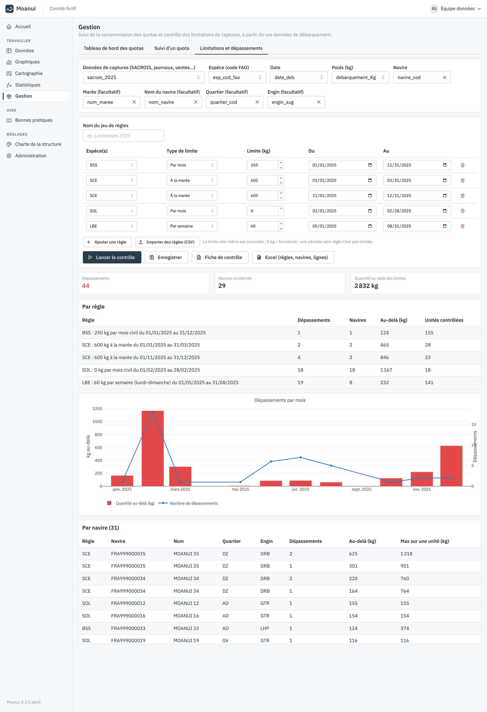

*Fiche de contrôle* (PDF ou Word) et *Excel* exportent les résultats ; le fichier Excel contient une feuille par règle, par navire, par mois et le détail des unités en dépassement. Les jeux de règles s'enregistrent pour être relancés sur les données du mois suivant.

> **Confidentialité.** Ces résultats citent des navires : ils relèvent de la gestion interne de la structure et ne doivent pas être diffusés en l'état.

# Partie 7 : Réglages et aide

## 17. Charte graphique de la structure

Les administrateurs de la structure règlent la **charte** : logo (utilisé dans l'en-tête et sur les graphiques), couleurs de l'interface, palette des graphiques (huit couleurs distinguables par les personnes daltoniennes, dans un ordre qui compte), dégradé des cartes de chaleur, source par défaut des graphiques, position du logo et police.

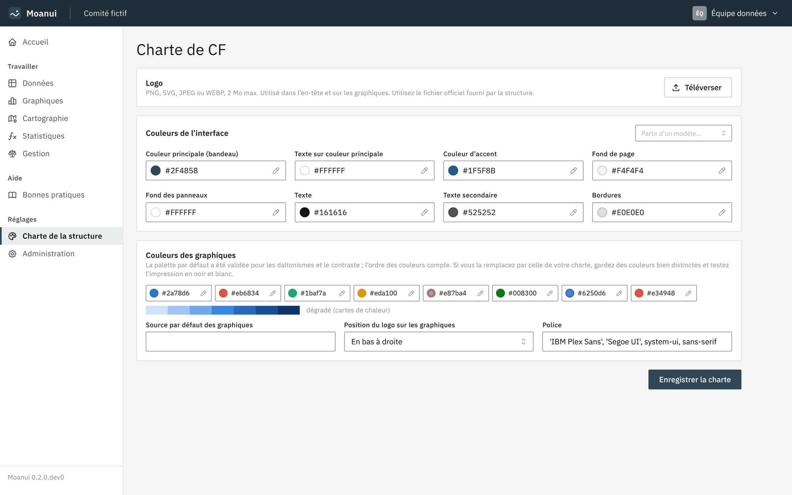

## 18. Administration

L'administrateur général crée les structures (avec une charte de départ), les comptes (identifiant, nom affiché, rôle dans chaque structure) et consulte le **journal d'activité** : qui a fait quoi, quand.

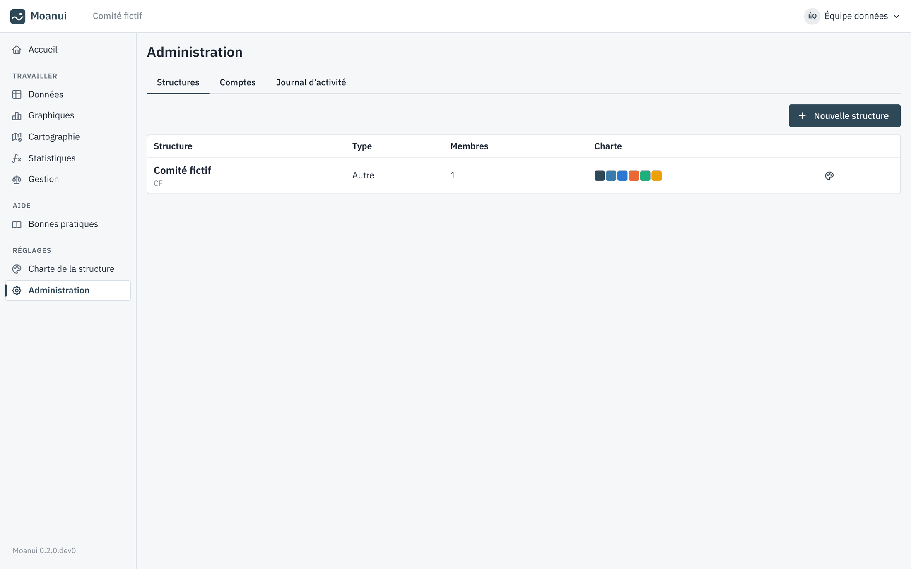

## 19. Bonnes pratiques

La page **Bonnes pratiques** rassemble les règles que Moanui applique ou vérifie, et les références sur lesquelles elles reposent : la donnée source ne change jamais, organiser et contrôler avant d'analyser, données halieutiques (SACROIS, engins, métiers), VMS et cartographie, secret statistique et données personnelles, tests statistiques, modèles de captures, graphiques justes. Les fiches méthode citent les mêmes sources.

## 20. Données de démonstration

Le dossier `exemples/donnees_demo` contient une flottille entièrement fictive pour s'entraîner : SACROIS 2023 à 2025 (avec des erreurs volontaires : codes mal saisis, doublons, engins incohérents, poids nuls, un extrait saisi en tonnes), fichier flotte, référentiels, VMS Agiltech et CLS 2025, suivi au casier, couches SIG (zone éolienne, gisements, cantonnements en Lambert-93, ports), quotas et limitations. Son fichier `LISEZMOI.md` déroule dix scénarios avec le résultat attendu à chaque étape ; toutes les figures de ce guide en sont issues.

## 21. Problèmes fréquents

Tableau : Problèmes fréquents et solutions
| Problème | Cause probable | Solution |
|---|---|---|
| La fenêtre noire s'ouvre et se referme aussitôt (version zip) | Fichiers extraits d'un téléchargement bloqués par Windows | Supprimer le dossier, débloquer le zip (Propriétés, Débloquer), extraire à nouveau ; ou utiliser l'installateur |
| « Windows a protégé votre ordinateur » | Application non signée | Informations complémentaires, puis Exécuter quand même |
| Moanui ne démarre pas, la fenêtre reste ouverte avec un message | Erreur au démarrage | Envoyer le fichier `moanui-erreur.log` (à côté de `Moanui.exe`) |
| Le navigateur ne s'ouvre pas | Navigateur par défaut absent | Ouvrir `http://127.0.0.1:8765` à la main |
| Toutes les valeurs d'une colonne sont du texte | Une valeur ne se convertit pas | Repérer la valeur (Contrôle qualité), la corriger, puis *Changer le type* |
| Une jointure ajoute des lignes | Clé en double dans l'autre jeu | Vérifier le message avant validation, dédoublonner le référentiel |
| Des résultats sont masqués (« secret ») | Moins de trois navires dans le groupe | Regrouper davantage (période, zone) ; c'est voulu |
| Les fonds IGN ou OpenStreetMap ne s'affichent pas | Pas d'accès Internet | Choisir le fond « Hors ligne » |

Pour tout autre problème, faites une capture d'écran et contactez la personne en charge de l'application.
